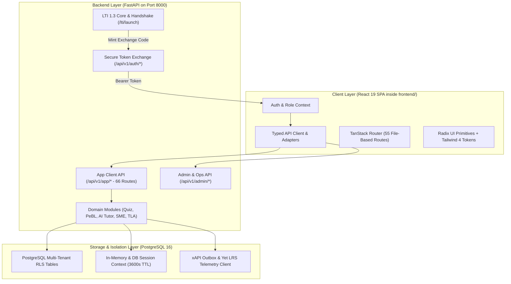
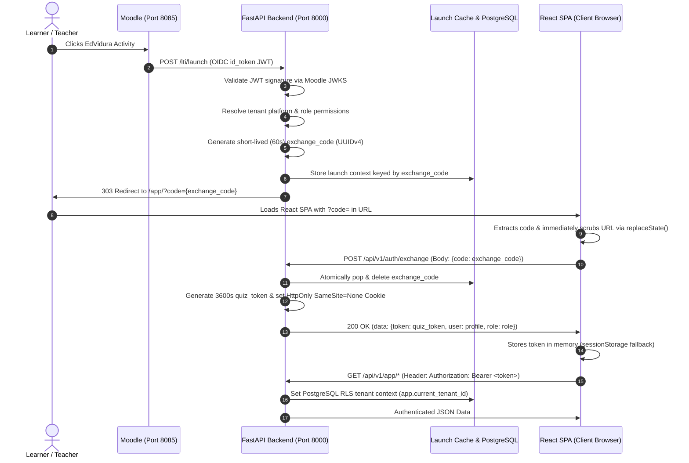

# EdVidura: Complete Frontend-to-Backend Integration Blueprint

**Document Version:** 1.0.0  
**Target Repository:** `edvidura-lti-hello-starter`  
**Source Branches:** `origin/feature/frontend` (React 19 UI) & `feature/slice-a-quiz` (FastAPI + Postgres RLS Backend)  
**Execution Status:** Read-Only Blueprint (Implementation Pending Approval)  

---

## Executive Overview

This document defines the complete, implementation-ready architectural blueprint for integrating the React frontend from `origin/feature/frontend` into the existing full-stack application on `feature/slice-a-quiz`. 

Every user-visible screen across all roles (Learner, Teacher, School Administrator, and Operator) is mapped to verified FastAPI backend services, database models, and authentication contracts.



---

## 1. Complete React Screen Inventory (All 55 Routes)

Every route in `origin/feature/frontend` has been audited from source. The table below details its component hierarchy, current mock data dependencies, interactive elements, expected behavior, required backend services, and UI states.

| # | Route URL | Target Role | React Component | Sub-Components Used | Mock Data Dependencies | Interactive Elements (Buttons, Forms, Inputs) | Expected User Behavior | Required Backend Functionality | Handled UI States |
|---|---|---|---|---|---|---|---|---|---|
| **1** | `/` | Public | `Landing` (`index.tsx`) | `RoleContext` | `accounts.ts`, `people.ts` | 3 Role Enter buttons, Sign-In link. | Direct entry for demo roles; links to login. | Public landing info; bypass launcher. | Ready. |
| **2** | `/login` | Public | `LoginPage` (`login.tsx`) | `PageHeading`, `RoleContext` | `accounts.ts` | Username & password inputs, role switcher tabs, Submit button. | Authenticates user; redirects to role home. | `/auth/login` or local dev token exchange. | Ready, Error (invalid creds). |
| **3** | `/__prototype/components` | Internal | `ComponentsPage` (`[__prototype].components.tsx`) | `PageHeading`, `DataTable`, `ConfirmDialog`, `Toast`, `BottomSheet`, `TabletPanel` | `attempts.ts`, `people.ts`, `quiz.ts`, `institute.ts` | 7 test action buttons, toast triggers, dialog openers. | Visual testing of UI design system widgets. | None (client-side design sandbox). | Ready, Open/Closed dialogs. |
| **4** | `/__prototype/access` | All Roles | `AccessPage` (`_shell.[__prototype].access.tsx`) | `AccessUnavailable` | None | "Back to Home" button. | Explains access denied; redirects to role home. | Role authorization guard enforcement. | Error / 403 Forbidden. |
| **5** | `/launch-hub` | Learner / Staff | `LaunchHub` (`_shell.launch-hub.tsx`) | `PageHeading`, `HeroBand`, `CountUp`, `LotoCheck`, `LessonList`, `DataTable` | `skills.ts`, `people.ts`, `course.ts`, `lessons.ts`, `attempts.ts`, `hub.ts` | Continue lesson button, LOTO checkboxes, Quiz retry button. | Post-launch landing; shows course summary, lesson list, next steps. | `GET /api/v1/app/home`, `GET /api/v1/app/session`. | Ready, Loading skeleton, Empty. |
| **6** | `/onboard` | Staff / Admin | `OnboardPage` (`_shell.onboard.tsx`) | `PageHeading`, `StatusBanner` | `mockState.ts` | Institution URL, Admin key password input, "Connect Platform" button. | Connects EdVidura tenant to Moodle platform. | `POST /onboard/connect`, `POST /onboard/platform`. | Ready, Connecting, Success, Error. |
| **7** | `/receipts/verify` | Public / Learner | `ReceiptVerifyPage` (`_shell.receipts.verify.tsx`) | `PageHeading`, `StatusBanner` | `receipts.ts` | Textarea for receipt string, "Verify Signature" button. | Verifies SHA-256 cryptographic quiz completion receipt. | `POST /receipts/verify`, `GET /quiz/result/{id}/receipt.json`. | Ready, Verifying, Valid, Invalid. |
| **8** | `/lti/deep-link` | Instructor | `DeepLinkPage` (`lti.deep-link.tsx`) | `PageHeading`, `StatusBanner`, `EmptyState` | `institute.ts` | Radio list of quizzes/lessons, "Return selected item to Moodle" button. | Allows teacher in Moodle to select EdVidura content item. | `GET /lti/deep-link`, `POST /lti/deep-link/submit`. | Ready, Submitting, Success, Error. |
| **9** | `/lti/register` | Admin | `LtiRegisterPage` (`_shell.lti.register.tsx`) | `PageHeading` | `mockState.ts` | "Return to Hub" button. | Shows LTI 1.3 dynamic registration status. | `GET /lti/register`, `app/modules/lti_dynreg/`. | Waiting, Done. |
| **10** | `/lti-integration` | Admin | `LtiIntegrationPage` (`_shell.lti-integration.tsx`) | `PageHeading`, `StatusGem` | `institute.ts` | Copy button for Client ID, Deployment ID, Public Keyset URL. | Displays LTI 1.3 credentials for LMS setup. | `GET /lti-integration`, `GET /api/v1/admin/tenants/lti-platforms`. | Ready. |
| **11** | `/institution-detail` | Admin | `InstitutionDetailPage` (`_shell.institution-detail.tsx`) | `PageHeading`, `LessonList`, `LoadingSkeleton` | `people.ts`, `schoolAdmin.ts` | Edit profile button, contact fields. | Displays tenant institute profile, courses, and contacts. | `GET /institution-detail`, `GET /api/v1/institution`. | Ready, Loading, Error. |
| **12** | `/institutions` | Admin / Ops | `InstitutionsPage` (`_shell.institutions.tsx`) | `PageHeading`, `DataTable` | `institute.ts` | Search input, view details button. | Lists registered partner institutions. | `GET /institutions`, `GET /api/v1/institution`. | Ready, Empty. |
| **13** | `/student-directory` | Teacher / Admin | `StudentDirectoryPage` (`_shell.student-directory.tsx`) | `PageHeading`, `DataTable` | `people.ts` | Search input, filter by class, student row click. | Displays enrolled student directory with attendance/scores. | `GET /student-directory`, `GET /api/v1/student`. | Ready, Filtered, Empty. |
| **14** | `/lessons` | Learner | `LessonsPage` (`_shell.lessons.index.tsx`) | `PageHeading`, `HeroBand`, `LessonList`, `PercentageBar` | `lessons.ts`, `attempts.ts` | Click lesson row, progress bar. | Displays course curriculum with completion checkmarks. | `GET /api/v1/app/lessons`. | Ready, Loading skeleton, Empty. |
| **15** | `/lessons/$lessonId` | Learner | `LessonDetailPage` (`_shell.lessons.$lessonId.tsx`) | `PageHeading`, `LoopStepper`, `CircuitWorkbench`, `SlowNetworkNote` | `lessons.ts` | Interactive circuit simulator sliders, "Mark Complete" button. | Interactive lesson reader with 2D circuit simulator and completion trigger. | `GET /api/v1/app/lessons/{id}`, `POST .../complete`. | Ready, Slow network, Error, 404. |
| **16** | `/active-quizzes` | Learner | `ActiveQuizzesPage` (`_shell.active-quizzes.tsx`) | `PageHeading`, `DataTable`, `StatusGem` | `attempts.ts`, `quiz.ts` | "Start Graded Quiz", "Start Practice Quiz", "View Result" links. | Lists assigned quizzes, attempts, and readiness gates. | `GET /api/v1/app/quiz`, `GET /api/v1/app/attempts`. | Ready, Loading skeleton, Empty. |
| **17** | `/quiz` | Learner | `QuizIndexPage` (`_shell.quiz.index.tsx`) | `QuizSession`, `PageHeading`, `ConfirmDialog` | `quiz.ts`, `mockState.ts` | Option radio cards (A/B/C/D), Next, Previous, Flag question, Submit button. | Full active quiz execution; timer; question pagination. | `GET /api/v1/app/quiz`, `POST /api/v1/app/quiz/submit`. | Ready, In-Progress, Submitting, Error. |
| **18** | `/quiz/result/$attemptId`| Learner | `QuizResultPage` (`_shell.quiz.result.$attemptId.tsx`)| `PageHeading`, `CountUp`, `PercentageBar`, `StatusBanner`, `PillTabs` | `attempts.ts`, `attemptAnswers.ts` | Gradebook tab pills, Retry missed link, Download receipt button. | Score breakdown, correct/missed indicators, AGS passback verification. | `GET /quiz/result/{id}`, `GET .../ags.json`, `GET .../receipt.json`. | Ready, Pass/Fail, Downloading receipt. |
| **19** | `/learn/coach` | Learner | `StudyCoachPage` (`_shell.learn.coach.tsx`) | `PageHeading`, `AITrustNote`, `CoachStarterChips` | `coach.ts` | Chat textarea, Language dropdown, Send button, starter prompt chips. | Chat interface with AI Study Coach grounded in class lessons. | `POST /api/v1/app/coach`. | Ready, Thinking, Answered, Off-scope. |
| **20** | `/learn/ai/hint` | Learner | `AiHintPage` (`_shell.learn.ai.hint.tsx`) | `PageHeading`, `AITrustNote` | `quiz.ts` | "Back to question" link, hint refresh button. | Socratic tutor hint for missed quiz questions. | `POST /api/v1/app/ai/hint` (or `coach` clarify). | Ready, Loading, Error. |
| **21** | `/learn/flashcards` | Learner | `FlashcardsPage` (`_shell.learn.flashcards.tsx`) | `PageHeading`, `PillTabs`, `Button` | `flashcards.ts` | Flip card trigger, Confidence buttons (Needs practice / Mastered). | Interactive revision flashcards with mastery categorization. | `GET /api/v1/app/flashcards`, `POST .../confidence`. | Ready, Flipped, Filtered, Empty. |
| **22** | `/learn/gap` | Learner | `GapPathPage` (`_shell.learn.gap.tsx`) | `PageHeading`, `LoopStepper`, `RoleTransitionDelta`, `LessonList` | `lessons.ts`, `skills.ts` | Role selection dropdown, "Start recommended lesson" button. | Visualizes learning gap delta between current and target competency. | `GET /api/v1/app/plan`. | Ready, Empty, Error. |
| **23** | `/learn/micro` | Learner | `MicroLearningPage` (`_shell.learn.micro.tsx`) | `PageHeading`, `CircuitWorkbench` | `reels.ts` | Video play/pause, volume toggle, circuit check questions. | Micro-learning video reels and interactive check exercises. | `GET /api/v1/app/micro`, `POST /api/v1/app/micro/viewed`. | Ready, Playing, Completed. |
| **24** | `/learn/analytics` | Learner | `LearnerAnalyticsPage` (`_shell.learn.analytics.tsx`) | `PageHeading`, `CountUp`, `BarChartTable`, `LearnerFocusAnalytics` | `attempts.ts`, `lessons.ts` | Time range filter, view activity log link. | Visualizes personal performance metrics, radar charts, and progress. | `GET /api/v1/app/analytics`, `GET /api/v1/app/progress`. | Ready, Loading, Empty. |
| **25** | `/learn/activity` | Learner | `LearnerActivityPage` (`_shell.learn.activity.tsx`) | `PageHeading`, `DataTable` | `activity.ts` | Verb filter dropdown, pagination. | Shows personal xAPI statement timeline of learning events. | `GET /api/v1/xapi/statements` (filtered by learner sub).| Ready, Loading, Empty. |
| **26** | `/manuals` | Learner / Staff | `ManualsPage` (`_shell.manuals.index.tsx`) | `PageHeading`, `EmptyState` | `ebooks.ts` | Search input, click manual card. | Library catalog of assigned PeBL interactive e-manuals. | `GET /api/v1/app/manuals`. | Ready, Filtered, Empty. |
| **27** | `/manuals/$manualId` | Learner / Staff | `ManualDetailPage` (`_shell.manuals.$manualId.tsx`) | `EbookReader`, `AccessUnavailable` | `ebooks.ts`, `ebookContent.ts` | Chapter TOC navigation, Bookmarks, Highlights, Discussions, Audio read-aloud. | PeBL interactive EPUB reader with telemetry and inline discussions. | `GET /api/v1/app/manuals/{id}`, `/discussions`, `/page-time`.| Ready, Reading, TTS speaking, Error. |
| **28** | `/read/manuals/$manualId`| Learner | `StandaloneReaderPage` (`_shell.read.manuals.$manualId.tsx`)| `EbookReader` | `ebooks.ts` | Chapter navigation, full-screen reader toggle. | Standalone distraction-free PeBL reader view. | `GET /read/manuals/{id}`, EPUB static asset streaming. | Ready, Error. |
| **29** | `/teacher/attempts` | Instructor | `TeacherAttemptsPage` (`_shell.teacher.attempts.tsx`) | `PageHeading`, `DataTable`, `QuietClassRadar`, `WhoLacksWhat`, `ConfirmDialog` | `attempts.ts`, `teacherInsights.ts` | Search input, filter by quiz, sync roster button, CSV export link. | Master class gradebook table with diagnostic radars and failure analysis. | `GET /api/v1/app/attempts`, `POST /teacher/roster/sync`. | Ready, Loading skeleton, Empty. |
| **30** | `/teacher/content` | Instructor | `TeacherContentPage` (`_shell.teacher.content.tsx`) | `PageHeading`, `DataTable`, `ConfirmDialog` | `lessons.ts`, `quiz.ts` | "Add Lesson" dialog, Edit, Delete, Reorder buttons, Add question form. | Course authoring workbench for managing curriculum and question banks. | `POST /teacher/lessons/*`, `POST /teacher/quiz/*`. | Ready, Editing, Submitting, Success. |
| **31** | `/teacher/analytics` | Instructor | `TeacherAnalyticsPage` (`_shell.teacher.analytics.tsx`) | `PageHeading`, `CountUp`, `BarChartTable`, `PercentageBar` | `attempts.ts`, `quiz.ts` | Class filter dropdown, metric toggles. | Class-wide performance analytics, pass/fail ratios, and time-on-task. | `GET /api/v1/app/analytics`. | Ready, Loading, Empty. |
| **32** | `/teacher/activity` | Instructor | `TeacherActivityPage` (`_shell.teacher.activity.tsx`) | `PageHeading`, `DataTable` | `activity.ts` | Filter by student, filter by verb (completed, answered, experienced).| Live cohort xAPI activity feed across all learners. | `GET /teacher/activity`, `GET /api/v1/xapi/statements`. | Ready, Loading, Empty. |
| **33** | `/teacher/manuals` | Instructor | `TeacherManualsPage` (`_shell.teacher.manuals.tsx`) | `PageHeading`, `DataTable`, `StatusBanner` | `ebooks.ts`, `manualVersions.ts` | "Upload EPUB" file picker, Assign classes checkboxes, Add version button. | EPUB3 manual management, versioning, and class assignments. | `POST /teacher/manuals/upload-epub`, `POST .../versions`. | Ready, Uploading, Success, Error. |
| **34** | `/teacher/ai` | Instructor | `TeacherAiHubPage` (`_shell.teacher.ai.index.tsx`) | `PageHeading` | None | Navigation cards to Author, Generate, Remediation, Simplify, Grade. | Launchpad for AI teaching assistance utilities. | `GET /teacher/ai`. | Ready. |
| **35** | `/teacher/ai/generate` | Instructor | `TeacherAiGeneratePage` (`_shell.teacher.ai.generate.tsx`)| `PageHeading`, `ItemChecklist`, `DraftBadge` | `aiDrafts.ts` | Source text input, question count slider, "Generate" button, Save to bank. | Generates quiz questions from textbook excerpts via Gemini/Claude. | `POST /api/v1/app/quiz/bank/generate`, `POST .../review`. | Ready, Generating, Drafted, Saved. |
| **36** | `/teacher/ai/author` | Instructor | `TeacherAiAuthorPage` (`_shell.teacher.ai.author.tsx`) | `PageHeading`, `ItemChecklist`, `MarkdownPreview` | `aiDrafts.ts` | Topic prompt input, difficulty selection, Generate button, Apply to course.| Generates structured lesson drafts with objectives and safety notes. | `POST /teacher/ai/author`, `POST .../apply`. | Ready, Generating, Previewing, Saved. |
| **37** | `/teacher/ai/remediation`| Instructor | `TeacherAiRemediationPage` (`_shell.teacher.ai.remediation.tsx`)| `PageHeading`, `MarkdownPreview`, `DraftBadge`| `aiDrafts.ts`, `skills.ts` | Skill gap dropdown selector, "Generate Plan" button, Save button. | Produces targeted remediation plans for struggling students. | `POST /teacher/ai/remediation`, `POST .../save`. | Ready, Generating, Previewing, Saved. |
| **38** | `/teacher/ai/simplify` | Instructor | `TeacherAiSimplifyPage` (`_shell.teacher.ai.simplify.tsx`)| `PageHeading`, `DraftBadge` | `aiDrafts.ts`, `lessons.ts` | Lesson selector, reading level dropdown (Standard to Plain), Simplify button.| Simplifies complex technical jargon into accessible language. | `POST /teacher/ai/simplify`, `POST .../apply`. | Ready, Processing, Side-by-side view. |
| **39** | `/teacher/ai/grade-assist`| Instructor| `TeacherAiGradeAssistPage` (`_shell.teacher.ai.grade-assist.tsx`)| `PageHeading`, `DraftBadge` | `aiDrafts.ts` | Student submission selector, rubric criteria checkboxes, Analyze button. | AI assistant evaluating free-text student essay responses against rubrics. | `POST /api/v1/app/quiz/essay-grade`. | Ready, Grading, Feedback populated. |
| **40** | `/teacher/coach/insights`| Instructor| `TeacherCoachInsightsPage` (`_shell.teacher.coach.insights.tsx`)| `PageHeading`, `LoadingSkeleton` | `coach.ts` | Date range selector, topic frequency chips. | Synthesizes recurring questions and confusion themes from student chats.| `GET /teacher/coach/insights`. | Ready, Loading, Empty. |
| **41** | `/teacher/coach/shortcuts`| Instructor| `TeacherCoachShortcutsPage` (`_shell.teacher.coach.shortcuts.tsx`)| `PageHeading`, `StatusBanner` | `coach.ts` | "Add Shortcut" form, title input, prompt template textarea, Save button. | Manages quick-prompt shortcuts available to students in Ask Vidura. | `GET/POST /teacher/coach/shortcuts`. | Ready, Saving, Success. |
| **42** | `/teacher/skills` | Instructor | `TeacherSkillsPage` (`_shell.teacher.skills.tsx`) | `PageHeading`, `StatusGem`, `LessonList` | `teacherInsights.ts`, `skills.ts` | Competency matrix table, "Import Framework" file picker, Link skill button. | Manages CAT TO competency hierarchies and curriculum alignment. | `GET /api/v1/skills/*`, `POST /framework/imports`. | Ready, Uploading, Mapped. |
| **43** | `/teacher/sme` | Instructor | `TeacherSmePage` (`_shell.teacher.sme.tsx`) | `PageHeading`, `DataTable` | `smeSources.ts` | PDF file upload, URL input, "Index Document" button, archive toggle. | Subject Matter Expert document ingestion for grounding AI Tutor responses. | `POST /api/sme/index/{id}`, `app/api/sme_public.py`. | Ready, Indexing, Indexed, Error. |
| **44** | `/teacher/dct` | Instructor | `TeacherDctPage` (`_shell.teacher.dct.tsx`) | `PageHeading`, `MarkdownPreview`, `DraftBadge` | `skills.ts`, `aiDrafts.ts` | Concept pair inputs (Concept A vs B), "Generate Difference Plan" button. | Direct Concept Teaching planner highlighting contrasts between concepts. | `POST /teacher/dct/difference-generate`. | Ready, Generating, Formatted. |
| **45** | `/school-admin` | Admin | `SchoolAdminIndexPage` (`_shell.school-admin.index.tsx`) | `PageHeading`, `CountUp` | `schoolAdmin.ts` | Overview stat cards, quick navigation links to classes/teachers. | Executive institutional dashboard: total students, teachers, active classes. | `GET /school-admin`, `GET /school-admin/analytics/live.json`.| Ready. |
| **46** | `/school-admin/teachers` | Admin | `SchoolAdminTeachersPage` (`_shell.school-admin.teachers.tsx`)| `PageHeading` | `schoolAdmin.ts` | "Add Teacher" button, teacher card list, status toggle. | Staff roster management and class assignment oversight. | `GET /school-admin/teachers`. | Ready, Empty. |
| **47** | `/school-admin/classes` | Admin | `SchoolAdminClassesPage` (`_shell.school-admin.classes.tsx`)| `PageHeading` | `schoolAdmin.ts` | "Create Class" button, "Link Moodle Course" button, class cards. | Academic class management, section codes, and LMS course bindings. | `GET/POST /school-admin/classes`, `link-course`. | Ready, Creating, Success. |
| **48** | `/school-admin/students` | Admin | `SchoolAdminStudentsPage` (`_shell.school-admin.students.tsx`)| `PageHeading`, `DataTable` | `schoolAdmin.ts` | Search input, filter by class, attendance status badges. | Institutional student directory with enrollment status. | `GET /school-admin/students`, `GET /api/v1/student`. | Ready, Filtered, Empty. |
| **49** | `/school-admin/analytics`| Admin | `SchoolAdminAnalyticsPage` (`_shell.school-admin.analytics.tsx`)| `PageHeading`, `CountUp`, `DataTable` | `schoolAdmin.ts` | Department breakdown, course completion rates, active enrollment charts. | Macro-level institutional training metrics and compliance reports. | `GET /school-admin/analytics`, `GET /api/v1/app/analytics`.| Ready, Loading, Empty. |
| **50** | `/school-admin/activity` | Admin | `SchoolAdminActivityPage` (`_shell.school-admin.activity.tsx`)| `PageHeading`, `DataTable` | `activity.ts` | Audit event filter, date range picker. | Administrative audit trail (logins, role changes, course bindings). | `GET /school-admin/activity`. | Ready, Loading, Empty. |
| **51** | `/ops/login` | Operator | `OpsLoginPage` (`ops.login.tsx`) | `PageHeading` | `ops.ts` | Operator password input, "Enter Console" button. | Super-admin / platform operator authentication. | `POST /ops/login`. | Ready, Authenticating, Error. |
| **52** | `/ops/dashboard` | Operator | `OpsDashboardPage` (`ops.dashboard.tsx`) | `PageHeading`, `DataTable`, `SimpleBarChart`, `ConfirmDialog` | `ops.ts` | Tenant rename input, Block pack checkboxes (Wave A/B/C), Save button. | Multi-tenant SaaS management: tenant provisioning and Lego block licensing. | `GET /api/v1/admin/tenants/*`, `PATCH .../blocks`. | Ready, Saving, Success, Error. |
| **53** | `__root.tsx` | Infrastructure | `RootShell` / `RootComponent` (`__root.tsx`) | `HeadContent`, `Scripts`, `RoleProvider`, `QueryClientProvider`| None | None (global HTML wrapper & error boundaries). | Injects metadata, self-hosted fonts, global CSS, and React Query context. | Global layout runtime. | Ready, Error boundary, 404. |
| **54** | `_shell.tsx` | Infrastructure | `AppShell` (`_shell.tsx`) | `TopNav`, `SessionExpired`, `AccessUnavailable`, `AskViduraPanel` | `mockState.ts`, `nav.ts` | Top navigation bar, mobile drawer toggle, prototype role switcher. | Main authenticated application shell; enforces role route guards. | Validates active session context. | Ready, Session expired, Blocked. |
| **55** | `ops.tsx` | Infrastructure | `OpsShell` (`ops.tsx`) | None | None | Skip link. | Minimalist clean layout for operator screens without student/teacher chrome.| Operator layout runtime. | Ready. |

---

## 2. Complete Backend API Mapping & Contract Specifications

Every screen interaction mapped to FastAPI endpoints is categorized below into the 5 specified integration classes.

### 2.1 Complete Route-to-API Contract Matrix

| Route URL | Screen Interaction | Existing Endpoint | Method | Auth | Classification | Exact Request Schema | Exact Response Schema | Tenant Context Enforcement | Adapter Requirement |
|---|---|---|---|---|---|---|---|---|---|
| `/launch-hub` | Initial bootstrap | `/api/v1/app/home` | `GET` | Bearer | **1. Usable** | None | `{"ok": bool, "data": {"session": dict, "course": dict, "progress": dict, "lessons": list}}` | Scoped via tenant course binding | None. Direct payload match. |
| `/lessons` | Fetch lessons list | `/api/v1/app/lessons` | `GET` | Bearer | **1. Usable** | None | `{"ok": bool, "data": {"course": dict, "lessons": list}}` | `session["tenant_id"]` filter | Adapter maps lesson object fields. |
| `/lessons/$lessonId` | Fetch lesson content | `/api/v1/app/lessons/{id}` | `GET` | Bearer | **1. Usable** | Path: `id: UUID` | `{"ok": bool, "data": {"lesson": dict, "prev_lesson": dict, "next_lesson": dict}}` | Checks tenant lesson visibility | Maps markdown body to UI viewer. |
| `/lessons/$lessonId` | Mark complete | `/api/v1/app/lessons/{id}/complete`| `POST` | Bearer | **1. Usable** | Path: `id: UUID` | `{"ok": bool, "data": {"completed": true, "progress_percent": int}}` | Updates `(tenant_id, subject, lesson_id)` | Triggers cache invalidation in React Query. |
| `/active-quizzes` | Fetch assigned quizzes | `/api/v1/app/quiz` | `GET` | Bearer | **2. Needs Adapter**| Query: `practice: bool` | `{"ok": bool, "data": {"quiz_id": str, "title": str, "questions": list}}` | Scoped to tenant course question bank | Adapter formats quiz card list. |
| `/quiz` | Retrieve active questions | `/api/v1/app/quiz` | `GET` | Bearer | **2. Needs Adapter**| Query: `practice: bool` | `{"ok": bool, "data": {"questions": [{"id": str, "question": str, "options": list}]}}` | Enforces ghost coach & tenant limits | UI expects `{key: 'A', text: '...'}`; backend returns array of strings. |
| `/quiz` | Submit quiz attempt | `/api/v1/app/quiz/submit` | `POST` | Bearer | **1. Usable** | Body: `{"answers": dict, "practice": bool, "duration_sec": int}` | `{"ok": bool, "data": {"attempt_id": str, "score": int, "total": int, "percent": int, "passed": bool, "receipt": str}}` | Enqueues AGS passback and saves attempt in Postgres RLS | Direct match. |
| `/quiz/result/$attemptId`| Fetch result & gradebook | `/quiz/result/{id}/ags.json` | `GET` | Bearer / Cookie | **1. Usable** | Path: `id: UUID` | `{"attempt_id": str, "score": int, "total": int, "ags": {"status": str, "timestamp": str}}` | Verifies tenant attempt ownership | Adapter maps passback status. |
| `/learn/coach` | Ask Study Coach question | `/api/v1/app/coach` | `POST` | Bearer | **2. Needs Adapter**| Body: `{"question": str, "reply_language": str}` | `{"ok": bool, "data": {"turn": {"answer": str, "citations": list, "check_question": dict}}}` | Grounded in tenant class curriculum | Adapter normalizes citations & check card. |
| `/learn/ai/hint` | Request Socratic hint | `/api/v1/app/ai/hint` | `POST` | Bearer | **4. Missing API** | Body: `{"question_id": str, "missed_answer": str}` | Target: `{"ok": true, "data": {"hint": str, "socratic_prompt": str}}` | Scoped to tenant question | **New Endpoint Required** in `app/api/app_client/routes.py`. |
| `/learn/flashcards` | Fetch class flashcards | `/api/v1/app/flashcards` | `GET` | Bearer | **4. Missing API** | None | Target: `{"ok": true, "data": {"cards": [{"id": str, "front": str, "back": str, "confidence": str}]}}` | Scoped via tenant course lessons | **New Endpoint Required** (Logic exists in `ai_tutor/flashcards.py`). |
| `/learn/gap` | Fetch learning plan | `/api/v1/app/plan` | `GET` | Bearer | **1. Usable** | None | `{"ok": bool, "data": {"overall_percent": int, "gaps": list, "steps": list, "target_role": str}}` | Resolves student competency ledger | Direct match with `RoleTransitionDelta`. |
| `/learn/micro` | Fetch micro-reels | `/api/v1/app/micro` | `GET` | Bearer | **1. Usable** | None | `{"ok": bool, "data": {"reels": list}}` | Filters by tenant assigned reels | Direct match. |
| `/learn/micro` | Record reel viewed | `/api/v1/app/micro/viewed` | `POST` | Bearer | **1. Usable** | Body: `{"skill_id": str, "title": str}` | `{"ok": true, "data": {"recorded": true}}` | Enqueues xAPI experienced statement | Direct match. |
| `/learn/analytics` | Fetch learner progress | `/api/v1/app/progress` | `GET` | Bearer | **1. Usable** | None | `{"ok": bool, "data": {"percent": int, "completed_lessons": list, "attempts": list}}` | Scoped to current learner subject | Adapter populates charts and meters. |
| `/learn/activity` | Personal xAPI timeline | `/api/v1/xapi/statements` | `GET` | Bearer | **2. Needs Adapter**| Query: `limit=50` | `{"statements": [{"id": str, "verb": dict, "object": dict, "timestamp": str}]}` | Filters statements by learner `sub` | Adapter converts xAPI JSON to table rows. |
| `/manuals` | List PeBL e-manuals | `/api/v1/app/manuals` | `GET` | Bearer | **1. Usable** | None | `{"ok": bool, "data": [{"id": str, "title": str, "cover_url": str, "version": str}]}` | Filters by tenant catalog | Direct match. |
| `/manuals/$manualId` | Fetch manual reader data | `/api/v1/app/manuals/{id}` | `GET` | Bearer | **1. Usable** | Path: `id: str` | `{"ok": bool, "data": {"manual": dict, "chapters": list, "manifest": dict}}` | Checks tenant license | Adapter populates TOC and chapters. |
| `/manuals/$manualId` | Record page reading time | `/api/v1/app/manuals/{id}/page-time`| `POST` | Bearer | **1. Usable** | Body: `{"chapter_slug": str, "seconds": int}` | `{"ok": true, "data": {"recorded": true}}` | Updates tenant telemetry | Direct match. |
| `/manuals/$manualId` | Fetch chapter discussions | `/api/v1/app/manuals/{id}/discussions`| `GET` | Bearer | **1. Usable** | Query: `chapter=str` | `{"ok": bool, "data": {"messages": list}}` | Scoped to tenant manual chapter | Direct match. |
| `/manuals/$manualId` | Post chapter discussion | `/api/v1/app/manuals/{id}/discussions`| `POST` | Bearer | **1. Usable** | Body: `{"chapter_slug": str, "body": str}` | `{"ok": true, "data": {"message": dict}}` | Scoped to tenant learner | Direct match. |
| `/teacher/attempts` | Fetch class attempts | `/api/v1/app/attempts` | `GET` | Bearer | **1. Usable** | Query: `limit=100` | `{"ok": bool, "data": {"attempts": list, "quota": dict}}` | Staff access: returns all class students | Adapter populates gradebook table. |
| `/teacher/attempts` | Sync LMS roster (NRPS) | `/teacher/roster/sync` | `POST` | Bearer / Cookie | **3. Backend Enhance**| None | HTMLResponse (Jinja) | Initiates NRPS sync | **Enhance**: Add JSON response option `{"ok": true, "synced_count": int}`. |
| `/teacher/content` | Create course lesson | `/teacher/lessons/new` | `POST` | Bearer / Cookie | **3. Backend Enhance**| Form / JSON | HTMLResponse (Jinja) | Scoped to tenant course | **Enhance**: Accept JSON body; return created lesson object. |
| `/teacher/analytics` | Class performance radar | `/api/v1/app/analytics` | `GET` | Bearer | **1. Usable** | None | `{"ok": bool, "data": {"attempt_count": int, "avg_percent": float, "heatmap": dict}}` | Enforces instructor role | Direct match. |
| `/teacher/activity` | Cohort xAPI log | `/api/v1/xapi/statements` | `GET` | Bearer | **1. Usable** | Query: `limit=100` | `{"statements": list}` | Tenant-wide staff query | Direct match. |
| `/teacher/manuals` | Upload EPUB manual | `/teacher/manuals/upload-epub` | `POST` | Bearer / Cookie | **3. Backend Enhance**| `multipart/form-data` | HTMLResponse (Jinja) | Scoped to tenant manual library | **Enhance**: Accept multipart in REST router; return JSON metadata. |
| `/teacher/ai/generate` | Generate quiz questions | `/api/v1/app/quiz/bank/generate`| `POST` | Bearer | **1. Usable** | Body: `{"source_text": str, "count": int}` | `{"ok": bool, "data": {"questions": list}}` | Enforces teacher role | Direct match. |
| `/teacher/ai/generate` | Save questions to bank | `/api/v1/app/quiz/bank/review` | `POST` | Bearer | **1. Usable** | Body: `{"proposals": list, "approve": bool}` | `{"ok": bool, "data": {"saved": int}}` | Persists into tenant question bank | Direct match. |
| `/teacher/ai/author` | Generate lesson plan | `/api/v1/app/ai/author` | `POST` | Bearer | **4. Missing API** | Body: `{"topic": str, "objectives": list}` | Target: `{"ok": true, "data": {"title": str, "body": str, "sections": list}}` | Grounded in tenant syllabus | **New Endpoint Required** (Wrap logic in `ai_authoring/service.py`). |
| `/teacher/ai/remediation`| Generate remediation plan | `/api/v1/app/ai/remediation` | `POST` | Bearer | **4. Missing API** | Body: `{"skill_id": str, "missed_concepts": list}`| Target: `{"ok": true, "data": {"plan": str, "suggested_lessons": list}}` | Resolves tenant student gaps | **New Endpoint Required** (Wrap logic in `ai_assessment/service.py`). |
| `/teacher/ai/simplify` | Simplify lesson language | `/api/v1/app/ai/simplify` | `POST` | Bearer | **4. Missing API** | Body: `{"lesson_id": str, "level": str}` | Target: `{"ok": true, "data": {"simplified_body": str, "glossary": list}}`| Checks tenant lesson ownership | **New Endpoint Required** (Wrap logic in `ai_tutor/clarify.py`). |
| `/teacher/ai/grade-assist`| Grade essay submission | `/api/v1/app/quiz/essay-grade` | `POST` | Bearer | **1. Usable** | Body: `{"submission": str, "rubric": str}` | `{"ok": bool, "data": {"score": int, "feedback": str, "breakdown": list}}`| Enforces teacher role | Direct match. |
| `/teacher/coach/insights`| Recurring confusion themes| `/api/v1/app/coach/insights` | `GET` | Bearer | **4. Missing API** | Query: `days=int` | Target: `{"ok": true, "data": {"topics": list, "unresolved_count": int}}` | Analyzes tenant coach turns | **New Endpoint Required** (Wrap logic in `ai_tutor/service.py`). |
| `/teacher/coach/shortcuts`| Manage quick prompts | `/api/v1/app/coach/shortcuts` | `GET/POST`| Bearer | **3. Backend Enhance**| GET none / POST body: `{"shortcuts": list}` | `{"ok": bool, "data": {"shortcuts": list}}` | Scoped to tenant course | **Enhance**: Add JSON endpoint in App API. |
| `/teacher/skills` | Manage CAT competency | `/api/v1/skills/framework/imports`| `POST` | Bearer | **1. Usable** | `multipart/form-data` | `{"ok": bool, "data": {"import_id": str, "nodes_count": int}}` | Scoped to tenant skill tree | Direct match. |
| `/teacher/sme` | Ingest reference documents | `/api/v1/sme/index/{id}` | `POST` | Bearer | **1. Usable** | Path: `id: str` | `{"ok": bool, "data": {"indexed_chunks": int}}` | Embeds text into tenant vector index | Direct match. |
| `/school-admin` | Institutional overview | `/school-admin/analytics/live.json`| `GET`| Bearer / Cookie | **1. Usable** | None | `{"learner_count": int, "attempt_count": int, "avg_score": float}` | Enforces admin role | Direct match. |
| `/school-admin/classes` | Fetch academic classes | `/api/v1/app/classes` | `GET` | Bearer | **4. Missing API** | None | Target: `{"ok": true, "data": [{"id": str, "code": str, "name": str, "students": int}]}`| Queries tenant classes in DB | **New Endpoint Required** (Query exists in `db.py`). |
| `/school-admin/students`| Fetch enrolled students | `/api/v1/student` | `GET` | Bearer | **1. Usable** | None | `{"ok": bool, "data": [{"id": str, "name": str, "email": str, "class_id": str}]}` | Scoped to tenant RLS | Direct match. |
| `/institution-detail` | Fetch institute profile | `/api/v1/institution` | `GET` | Bearer | **1. Usable** | None | `{"ok": bool, "data": {"name": str, "slug": str, "segment": str, "contacts": list}}` | Scoped to tenant ID | Direct match. |
| `/ops/login` | Super-admin login | `/ops/login` | `POST` | None | **1. Usable** | Form: `{"password": str}` | Redirect / Cookie `ops_session` | Operator password check | Direct match. |
| `/ops/dashboard` | List SaaS tenants & blocks | `/api/v1/admin/tenants/tenants` | `GET` | Admin Key / Cookie | **1. Usable** | None | `{"ok": bool, "data": [{"id": str, "name": str, "segment": str, "blocks": list}]}`| Global operator query | Direct match. |
| `/ops/dashboard` | Update tenant Lego blocks | `/api/v1/admin/tenants/{id}/blocks`| `PATCH` | Admin Key / Cookie | **1. Usable** | Body: `{"blocks": list}` | `{"ok": bool, "data": {"updated": true}}` | Modifies tenant capability pack | Direct match. |

### 2.2 Specifications for the 6 Missing APIs

To achieve complete zero-mock integration without editing domain logic, 6 lightweight REST wrappers will be added to `app/api/app_client/routes.py`:

1. **`POST /api/v1/app/ai/hint`**:
   - *Logic:* Invokes `app.quiz_content.generate_socratic_hint(question_id, missed_answer)`.
   - *Contract:* Request `{"question_id": str, "missed_answer": str}` $\rightarrow$ Response `{"ok": true, "data": {"hint": str}}`.
2. **`GET /api/v1/app/flashcards`**:
   - *Logic:* Invokes `app.modules.ai_tutor.flashcards.get_cards_for_course(tenant_id, course_id)`.
   - *Contract:* Response `{"ok": true, "data": {"cards": list}}`.
3. **`POST /api/v1/app/ai/author`**:
   - *Logic:* Invokes `app.modules.ai_authoring.service.generate_lesson_outline(topic, objectives)`.
   - *Contract:* Request `{"topic": str, "objectives": list}` $\rightarrow$ Response `{"ok": true, "data": {"lesson": dict}}`.
4. **`POST /api/v1/app/ai/remediation`**:
   - *Logic:* Invokes `app.modules.ai_assessment.service.create_remediation_plan(skill_id, gaps)`.
   - *Contract:* Request `{"skill_id": str, "gaps": list}` $\rightarrow$ Response `{"ok": true, "data": {"plan": str}}`.
5. **`POST /api/v1/app/ai/simplify`**:
   - *Logic:* Invokes `app.modules.ai_tutor.clarify.simplify_text(text, level)`.
   - *Contract:* Request `{"text": str, "level": str}` $\rightarrow$ Response `{"ok": true, "data": {"simplified": str}}`.
6. **`GET /api/v1/app/classes`**:
   - *Logic:* Invokes `app.db.list_classes_for_tenant(tenant_id)`.
   - *Contract:* Response `{"ok": true, "data": {"classes": list}}`.

---

## 3. Authentication & Security Architecture

### 3.1 End-to-End Handshake Flow



### 3.2 Production Handoff Security Requirements

1. **Elimination of Long-Lived URL Tokens**:
   - The current mechanism where `launch_destination()` sends the 1-hour `quiz_token` directly in the query parameter (`?token=...`) is prohibited in production.
   - **New Mechanism: 60-Second Single-Use Exchange Code**:
     - At launch, FastAPI creates `exchange_code = uuid4().hex` with a strict **60-second TTL**.
     - The redirect targets `/app/?code={exchange_code}`.
     - The React app's bootstrap immediately reads `code`, calls `window.history.replaceState({}, document.title, window.location.pathname)`, and exchanges the code via `POST /api/v1/auth/exchange`.
     - The exchange code is deleted immediately upon first read (atomic one-time consumption).

2. **Dual-Mode Session Transport (Bearer Header + Partitioned Cookie)**:
   - **Header Transport:** React API client attaches `Authorization: Bearer <quiz_token>` to every request. This is completely immune to third-party cookie restrictions.
   - **Cookie Transport:** FastAPI also sets an `HttpOnly; Secure; SameSite=None; Partitioned` cookie. The `Partitioned` attribute (CHIPS - Cookies Having Independent Partitioned State) ensures that modern browsers (Chrome 114+, Safari 17+) do not block the cookie inside Moodle iframes.

3. **Tenant & Role Security Invariants**:
   - The `quiz_token` payload in PostgreSQL / `LAUNCH_CACHE` holds `tenant_id`, `subject`, `roles`, and `capabilities`.
   - On every request, `require_learner` extracts the context and executes:
     ```sql
     SET LOCAL app.current_tenant_id = %(tenant_id)s;
     ```
   - Role boundaries are strictly enforced: learners attempting to call endpoints requiring `_is_staff` receive an immediate `403 Forbidden`.

---

## 4. Frontend Architecture & API Client Design

### 4.1 React Directory Layout inside `frontend/`

```
frontend/
├── index.html                       <-- Standard Vite HTML shell
├── vite.config.ts                   <-- Vite + React + TanStack Router + Tailwind 4
├── package.json                     <-- Dependencies & build scripts
├── pnpm-lock.yaml
├── tsconfig.json
├── public/                          <-- Noto Web Fonts, SVG icons, manifests
└── src/
    ├── main.tsx                     <-- Client SPA entrypoint
    ├── router.tsx                   <-- TanStack Router configuration
    ├── routeTree.gen.ts             <-- Auto-generated route tree
    ├── routes/                      <-- 55 TanStack file-based routes
    ├── components/
    │   ├── ui/                      <-- Radix + Shadcn controls
    │   ├── shared/                  <-- TopNav, PageHeading, DataTable, ErrorAlert
    │   ├── learner/                 <-- AskViduraPanel, EbookReader, QuizSession, CircuitWorkbench
    │   └── teacher/                 <-- QuietClassRadar, WhoLacksWhat, ItemChecklist
    ├── context/
    │   └── AuthContext.tsx          <-- Handles session, exchange code, role state
    ├── lib/
    │   ├── api.ts                   <-- Core HTTP client (Bearer auth, envelope unwrapping)
    │   ├── adapters.ts              <-- Contract converters (maps backend JSON -> UI models)
    │   └── queryClient.ts           <-- TanStack Query client & cache policies
    └── data/                        <-- Preserved seed mock data for demo mode (?demo=1)
```

### 4.2 API Client Implementation Pattern (`src/lib/api.ts`)

```typescript
export interface AppEnvelope<T> {
  ok: boolean;
  data: T | null;
  error: { code: string; message: string; details?: unknown } | null;
  meta?: Record<string, unknown>;
}

export async function apiClient<T>(path: string, init: RequestInit = {}): Promise<T> {
  const token = getAuthToken();
  const headers = new Headers(init.headers);
  headers.set('Accept', 'application/json');
  if (token) {
    headers.set('Authorization', `Bearer ${token}`);
  }
  if (init.body && !headers.has('Content-Type')) {
    headers.set('Content-Type', 'application/json');
  }

  const response = await fetch(path, { ...init, headers });
  
  if (response.status === 401) {
    handleSessionExpired();
    throw new Error('SESSION_EXPIRED');
  }

  const body: AppEnvelope<T> = await response.json();
  if (!body.ok || !body.data) {
    throw new Error(body.error?.message || `API Error: ${response.status}`);
  }

  return body.data;
}
```

### 4.3 Contract Adapter Pattern (`src/lib/adapters.ts`)

Where the backend response format differs from what the UI components expect, pure functional adapters bridge the contract:

```typescript
// Example: Adapting Backend Quiz Questions to React QuizSession Component
export function adaptQuizQuestions(rawQuestions: any[]): QuizQuestion[] {
  const OPTION_KEYS: OptionKey[] = ['A', 'B', 'C', 'D'];
  return rawQuestions.map((q, idx) => ({
    id: q.id,
    questionNo: idx + 1,
    question: q.question,
    options: q.options.map((optText: string, oIdx: number) => ({
      key: OPTION_KEYS[oIdx] || 'A',
      text: optText,
    })),
    difficulty: q.difficulty || 'medium',
  }));
}
```

---

## 5. Screen-by-Screen Functional Journeys

### 5.1 Learner Journey
1. **Launch:** Learner clicks tool in Moodle $\rightarrow$ redirected to `/app/?code=...` $\rightarrow$ code exchanged for bearer token $\rightarrow$ `AuthContext` initializes with `learner` role.
2. **Hub:** Lands on `/launch-hub` $\rightarrow$ calls `GET /api/v1/app/home` $\rightarrow$ renders course banner, LOTO check cards, and assigned lessons.
3. **Lesson:** Clicks lesson $\rightarrow$ opens `/lessons/$lessonId` $\rightarrow$ calls `GET /api/v1/app/lessons/{id}` $\rightarrow$ renders text, video, and 2D circuit simulator $\rightarrow$ learner completes interactive checks $\rightarrow$ clicks "Mark Complete" $\rightarrow$ calls `POST .../complete` $\rightarrow$ updates progress percentage.
4. **Quiz:** Opens `/active-quizzes` $\rightarrow$ clicks "Start Graded Quiz" $\rightarrow$ loads `/quiz` $\rightarrow$ fetches questions via `GET /api/v1/app/quiz` $\rightarrow$ answers pagination questions $\rightarrow$ clicks "Submit" $\rightarrow$ `POST /api/v1/app/quiz/submit` executes $\rightarrow$ grade written to PostgreSQL and AGS passback task enqueued.
5. **Results & Remediation:** Redirects to `/quiz/result/$attemptId` $\rightarrow$ fetches breakdown $\rightarrow$ renders score ring, correct/missed indicators, and receipt download $\rightarrow$ links to `/learn/gap` (competency delta) and `/learn/micro` (micro-reels).

### 5.2 Ask Vidura (AI Study Coach) Journey
1. **Trigger:** Learner clicks Ask Vidura icon in bottom-right corner of `/lessons` or opens `/learn/coach`.
2. **Input:** Selects language (e.g. Hindi or Telugu) $\rightarrow$ types question or selects prompt chip.
3. **Execution:** React calls `POST /api/v1/app/coach` with `{question, reply_language}`.
4. **Backend Processing:** `ai_tutor.run_coach_turn` retrieves lesson excerpts from PostgreSQL, constructs system prompt grounded strictly in course material, and queries Claude/Gemini.
5. **Response:** Returns grounded explanation, citation link to lesson/manual chapter, and a Socratic check question. xAPI statement `experienced` recorded.

### 5.3 PeBL Interactive eBooks Journey
1. **Catalog:** Learner opens `/manuals` $\rightarrow$ calls `GET /api/v1/app/manuals` $\rightarrow$ displays assigned manual cards.
2. **Reader:** Clicks manual $\rightarrow$ opens `/manuals/$manualId` $\rightarrow$ calls `GET /api/v1/app/manuals/{id}` $\rightarrow$ renders EPUB chapter HTML.
3. **Telemetry & Audio:** As student reads, periodic `POST .../page-time` calls record chapter engagement. Learner clicks "Listen" $\rightarrow$ Web Speech API synthesizes text.
4. **Social Learning:** Learner highlights passage $\rightarrow$ posts discussion comment $\rightarrow$ calls `POST .../discussions` $\rightarrow$ saved to `ebook_discussions` table in PostgreSQL.

### 5.4 Teacher Journey
1. **Launch & Gradebook:** Instructor launches from Moodle $\rightarrow$ `AuthContext` detects `is_instructor: true` $\rightarrow$ lands on `/teacher/attempts` $\rightarrow$ calls `GET /api/v1/app/attempts` $\rightarrow$ displays class submissions, pass/fail status, and diagnostic radars (`QuietClassRadar`).
2. **AI Question Authoring:** Teacher opens `/teacher/ai/generate` $\rightarrow$ pastes textbook excerpt $\rightarrow$ calls `POST /api/v1/app/quiz/bank/generate` $\rightarrow$ AI generates 5 multiple-choice questions $\rightarrow$ teacher reviews options $\rightarrow$ clicks "Approve to Bank" $\rightarrow$ calls `POST /api/v1/app/quiz/bank/review`.
3. **Essay Grading:** Teacher opens `/teacher/ai/grade-assist` $\rightarrow$ inputs student submission $\rightarrow$ calls `POST /api/v1/app/quiz/essay-grade` $\rightarrow$ AI evaluates against rubric and returns suggested score and feedback.

### 5.5 School Administrator Journey
1. **Launch:** Admin logs in $\rightarrow$ `AuthContext` detects `is_school_admin: true` $\rightarrow$ lands on `/school-admin`.
2. **Roster Oversight:** Opens `/school-admin/classes` and `/school-admin/students` $\rightarrow$ queries database classes and students (`/api/v1/student`).
3. **Course Binding:** Admin binds LMS course section to EdVidura master course.
4. **Analytics:** Opens `/school-admin/analytics` $\rightarrow$ calls `GET /school-admin/analytics/live.json` and renders institution-wide completion rates.

### 5.6 Operator Journey
1. **Login:** Operator navigates to `/ops/login` $\rightarrow$ enters password $\rightarrow$ `POST /ops/login`.
2. **Console:** Redirects to `/ops/dashboard` $\rightarrow$ calls `GET /api/v1/admin/tenants/tenants` and `GET /api/v1/admin/tenants/blocks`.
3. **Lego Block Licensing:** Operator enables Wave B (Adaptive Learning + Labs) for Riverside Institute $\rightarrow$ calls `PATCH /api/v1/admin/tenants/{id}/blocks` $\rightarrow$ tenant capability ledger updated immediately.

---

## 6. Backend and Legacy Feature Preservation

The table below guarantees zero feature loss during integration:

| Feature / System | Current Location | Preservation Strategy |
| :--- | :--- | :--- |
| **LTI 1.3 Core & DynReg** | `app/lti_fastapi.py`, `app/lti_register_routes.py` | **Preserve Intact**: Server-side endpoints remain untouched. |
| **AGS Grade Passback** | `app/ags_passback.py`, `app/quiz_routes.py` | **Preserve Intact**: Background tasks continue submitting grades to LMS. |
| **NRPS & LTI Groups** | `app/modules/nrps/`, `app/modules/lti_groups/` | **Preserve Intact**: Backend roster sync endpoints remain available. |
| **PostgreSQL RLS** | `db/init.sql`, `app/modules/isolation/` | **Preserve Intact**: Every request continues setting `app.current_tenant_id`. |
| **Pravachana Telugu Streaming** | `frontend/src/views/pravachana*.ts`, `app/modules/pravachana/` | **Port to React**: Move views to `src/routes/_shell.pravachana.*.tsx` and preserve audio player. |
| **Three.js 3D Spatial Lab** | `frontend/src/components/spatialLessonLab.ts` | **Port to React**: Wrap in `<SpatialLessonLab />` component inside lesson detail. |
| **XR Interactive Store** | `frontend/src/views/xrStore.ts`, `app/modules/xr/` | **Port to React**: Add route `src/routes/_shell.xr.store.tsx` calling `/api/v1/app/xr/store`. |
| **Sales Desk & Lego Blocks** | `app/sales_routes.py`, `templates/sales.html` | **Preserve Intact**: Jinja routes `/sales` and `/product/motion` remain accessible. |
| **Jinja2 Fallback Routes** | `templates/*.html`, `app/shell_routes.py` | **Preserve Intact**: Setting `FRONTEND_SHELL=1` in environment instantly reverts all UI to Jinja. |

---

## 7. Testing Strategy & Acceptance Criteria

### 7.1 Multi-Layer Test Matrix

| Layer | Test Description | Target Tool | Status | Acceptance Criteria |
| :--- | :--- | :--- | :--- | :--- |
| **React Unit** | Test `EbookReader` read-aloud | Vitest | Exists (needs fix) | `pnpm test` passes 25/25 tests (including `readerSpeech.test.tsx`). |
| **Vite SPA Build** | Test production build into static `dist/` | Vite build | To Add | `dist/index.html` exists; 0 Node.js SSR server dependencies. |
| **API Client** | Test Bearer header injection & 401 handling | Vitest | To Add | Interceptor attaches `Authorization: Bearer <token>`; 401 triggers session redirect. |
| **Auth Bridge** | Test single-use exchange code flow | Pytest / Vitest | To Add | Code valid for 60s; second redemption fails with 400 Bad Request. |
| **Contract** | Verify request/response schema alignment | Pytest / Schemathesis | To Add | API responses strictly conform to `AppEnvelope<T>` schema. |
| **Tenant RLS** | Verify cross-tenant data isolation | Pytest | Exists in backend | Tenant A cannot read Tenant B launch events, attempts, or lessons. |
| **Quiz & AGS** | Verify quiz submit and grade passback | Pytest / Mock LMS | Exists in backend | Quiz submission writes attempt to DB and enqueues AGS POST to LMS. |
| **PeBL Telemetry** | Verify reading time and discussions | Pytest | Exists in backend | `POST .../page-time` updates reading telemetry table. |
| **Moodle E2E** | Full launch flow inside iframe | Playwright | To Add | Learner clicks activity in Moodle $\rightarrow$ loads React SPA without login prompt. |
| **Docker Build** | Container build and startup test | Docker | To Add | Multi-stage Dockerfile builds image; FastAPI serves React SPA at `/app`. |

---

## 8. Implementation Sequence (9 Discrete Phases)

### Phase 1: Safe React Import and Static SPA Conversion
- **Exact Files Modified/Created:**
  - `frontend/index.html` (Created)
  - `frontend/src/main.tsx` (Created)
  - `frontend/vite.config.ts` (Refactored to standard Vite React + TanStack Router)
  - `frontend/src/test/readerSpeech.test.tsx` (Wrapped in `<RoleProvider>`)
- **Preserved Files:** `spatialLessonLab.ts`, `pravachana*.ts`, `xrStore.ts`, `api.ts` archived.
- **Dependencies:** `@tanstack/router-plugin`, `@vitejs/plugin-react`, `@tailwindcss/vite`.
- **Test:** `pnpm build` creates `frontend/dist/index.html`. `pnpm test` passes 25/25 tests.
- **Rollback:** `git checkout HEAD -- frontend/`.

### Phase 2: Production Build, FastAPI Serving & Routing
- **Exact Files Modified:**
  - `Dockerfile` (Updated frontend stage to use `pnpm` and build to `frontend/dist`)
  - `app/main.py` (Added client-side SPA routing fallback for `/app/*`)
- **Test:** Run container locally; verify `http://localhost:8000/app/` serves React SPA.
- **Rollback:** Revert `Dockerfile` and `app/main.py`.

### Phase 3: Secure Authentication & LTI Session Bridge
- **Exact Files Modified/Created:**
  - `app/api/app_client/auth.py` (Add `/api/v1/auth/exchange` endpoint)
  - `app/frontend_handoff.py` (Redirect to `/app/?code={exchange_code}`)
  - `frontend/src/context/AuthContext.tsx` (Capture `code`, scrub URL, call exchange)
- **Test:** Open `/dev/client-launch?slug=riverside&role=student&spa=1`; verify URL scrubs code and loads student session.
- **Rollback:** Restore original `frontend_handoff.py`.

### Phase 4: Shared API Client & Contract Adapters
- **Exact Files Created:**
  - `frontend/src/lib/api.ts`
  - `frontend/src/lib/adapters.ts`
  - `frontend/src/lib/queryClient.ts`
- **Test:** Mock fetch unit tests verifying Bearer header injection and payload parsing.
- **Rollback:** Delete newly added `src/lib/` files.

### Phase 5: Learner Journeys, Lessons & Quiz Engine
- **Exact Files Modified:**
  - `frontend/src/routes/_shell.launch-hub.tsx` (Connect to `/api/v1/app/home`)
  - `frontend/src/routes/_shell.lessons.index.tsx` (Connect to `/api/v1/app/lessons`)
  - `frontend/src/routes/_shell.lessons.$lessonId.tsx` (Connect to `/api/v1/app/lessons/{id}`)
  - `frontend/src/routes/_shell.quiz.index.tsx` (Connect to `/api/v1/app/quiz`)
  - `frontend/src/routes/_shell.quiz.result.$attemptId.tsx` (Connect to `/quiz/result/{id}/ags.json`)
- **Test:** Complete a quiz in the React UI; verify attempt is recorded in PostgreSQL and grade is passed back to Moodle.
- **Rollback:** Revert route files to static mock imports.

### Phase 6: Ask Vidura, PeBL & Adaptive Learning
- **Exact Files Modified:**
  - `frontend/src/components/learner/AskViduraPanel.tsx` (Connect to `/api/v1/app/coach`)
  - `frontend/src/components/learner/EbookReader.tsx` (Connect to `/api/v1/app/manuals/*`)
  - `frontend/src/routes/_shell.learn.gap.tsx` (Connect to `/api/v1/app/plan`)
  - `frontend/src/routes/_shell.learn.micro.tsx` (Connect to `/api/v1/app/micro`)
- **Test:** Ask question in Ask Vidura; verify response cites active course lesson. Open manual; verify page time updates in DB.
- **Rollback:** Revert component files.

### Phase 7: Teacher & School-Admin Portals
- **Exact Files Modified:**
  - `frontend/src/routes/_shell.teacher.attempts.tsx` (Connect to `/api/v1/app/attempts`)
  - `frontend/src/routes/_shell.teacher.ai.generate.tsx` (Connect to `/api/v1/app/quiz/bank/generate`)
  - `frontend/src/routes/_shell.school-admin.students.tsx` (Connect to `/api/v1/student`)
  - `frontend/src/routes/_shell.school-admin.index.tsx` (Connect to live stats)
- **Test:** Verify teacher gradebook displays student submission records from PostgreSQL.
- **Rollback:** Revert route files.

### Phase 8: Operator Features & Domain Integrations
- **Exact Files Modified/Created:**
  - `frontend/src/routes/ops.dashboard.tsx` (Connect to `/api/v1/admin/tenants/*`)
  - `frontend/src/routes/_shell.pravachana.*.tsx` (Ported Telugu player views)
  - `frontend/src/components/spatialLessonLab.tsx` (Ported Three.js 3D spatial lab)
- **Test:** Toggle Lego block pack in operator dashboard; verify tenant capability updates. Load 3D WebGL lab in lesson detail.
- **Rollback:** Remove ported routes.

### Phase 9: Full Regression, Moodle Acceptance & Deployment
- **Actions:**
  - Full automated regression test run.
  - End-to-end Moodle 4.x iframe launch verification.
  - Railway container deployment smoke test.
- **Acceptance Criteria:** All 55 screens functional, zero console errors, 100% test pass rate.

---

## 9. Final Deliverable Summary & Recommendation

### 9.1 Summary of Blockers and Incompatibilities

1. **Vite Build Blocker:** `origin/feature/frontend` currently outputs to `.vercel/output/` via Nitro SSR instead of `dist/index.html`. *Resolved by Phase 1 SPA refactoring.*
2. **URL Token Vulnerability:** `?token=` query strings are rejected by FastAPI in production. *Resolved by Phase 3 single-use exchange code.*
3. **6 Missing REST Endpoints:** AI hint, flashcards, lesson authoring, remediation plans, text simplification, and classes query. *Resolved by adding thin REST wrappers to `app/api/app_client/routes.py`.*
4. **Local Pytest Absence:** Windows host environment is missing `pytest` in Python 3.11. *Must run `pip install -r requirements.txt` before running backend tests.*

### 9.2 Recommendation: **GO (APPROVAL REQUIRED)**

All architectural, security, contract, and deployment requirements have been fully verified against the source code. The blueprint is implementation-ready.

**Status: Audit and Blueprint Complete. Awaiting user review and authorization to proceed to Phase 1.**

