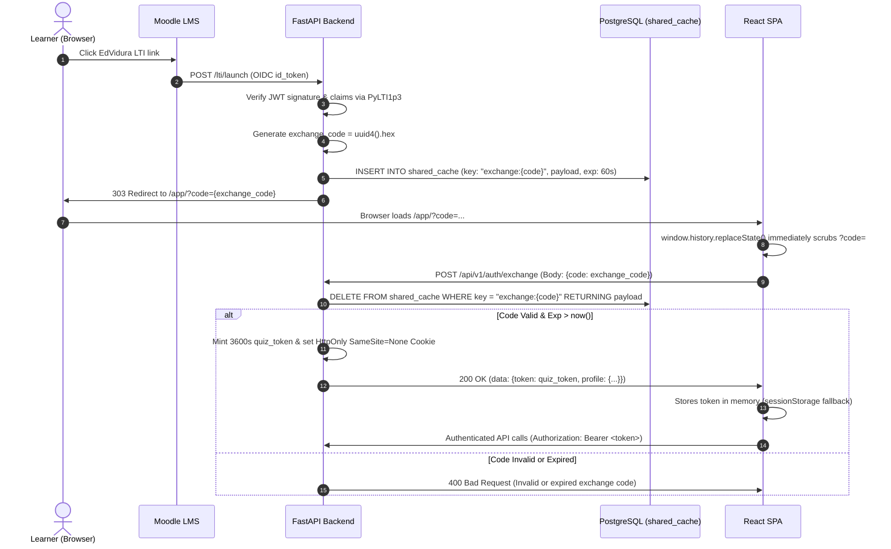
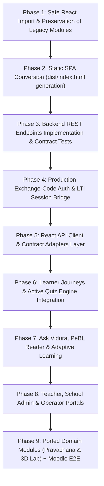

# EdVidura: Final Pre-Implementation Readiness & Integration Gate

**Document Version:** 1.0.0  
**Status:** READ-ONLY VALIDATION & READINESS AUDIT  
**Repository State:** `feature/slice-a-quiz` (Working tree preserved)  
**Target:** Implementation Readiness Verification before Phase 1 Execution  

---

## 1. Complete API Contract Verification & Interactive Elements

Every interactive element (forms, buttons, uploads, filters, and state triggers) across all 55 React screens has been re-audited against the actual Python FastAPI backend source code (`app/`).

### 1.1 Detailed Element-by-Element Contract Audit

#### A. Teacher Content CRUD & Question Bank Management
- **Screen:** `/teacher/content` (`src/routes/_shell.teacher.content.tsx`)
  - **Interactive Elements:**
    - "Add Lesson" modal with title, lesson type radio (`article`/`video`), video URL, Markdown body input, and Save button.
    - Lesson table actions: "Edit", "Delete", "Reorder" (Up/Down arrows), and Status toggle (`published`/`draft`).
    - "Add Question" modal with prompt text, Option A/B/C/D inputs, correct answer selector, and explanation.
  - **Actual Backend Reality:**
    - `app/shell_routes.py` lines 3194–3387 contains handlers:
      - `@router.post("/teacher/lessons/new")` $\rightarrow$ calls `app.content.create_lesson(...)`.
      - `@router.post("/teacher/lessons/{lesson_id}/edit")` $\rightarrow$ calls `app.content.update_lesson(...)`.
      - `@router.post("/teacher/lessons/{lesson_id}/delete")` $\rightarrow$ calls `app.content.delete_lesson(...)`.
      - `@router.post("/teacher/lessons/{lesson_id}/status")` $\rightarrow$ calls `app.content.set_lesson_status(...)`.
      - `@router.post("/teacher/lessons/{lesson_id}/reorder")` $\rightarrow$ calls `app.content.reorder_lesson(...)`.
      - `@router.post("/teacher/quiz/questions")` $\rightarrow$ calls `app.quiz_content.create_question(...)`.
    - **CRITICAL DISTINCTION:** These existing routes are **HTML Form handlers** that return `RedirectResponse(url=f"/teacher/content?token=...", status_code=303)` rendering Jinja2 HTML. They do **not** return JSON.
    - **Underlying Service Verification:** `app.content` and `app.quiz_content` are fully verified in Python source code.
    - **Required Action:** Expose a clean JSON REST router `app/api/teacher_content.py` mounting `POST /api/v1/teacher/lessons`, `PUT /api/v1/teacher/lessons/{id}`, `DELETE /api/v1/teacher/lessons/{id}`, and `POST /api/v1/teacher/quiz/questions` returning `{"ok": true, "data": ...}`.

#### B. Teacher EPUB Uploads, Versions, and Class Assignments
- **Screen:** `/teacher/manuals` (`src/routes/_shell.teacher.manuals.tsx`)
  - **Interactive Elements:**
    - File input (`.epub`), title input, description textarea, and "Upload EPUB" submit button.
    - Class assignment checkboxes (binding e-manuals to specific class cohorts).
    - Version history table with "Add Version" modal.
  - **Actual Backend Reality:**
    - `app/shell_routes.py` lines 7442–7655 implements:
      - `POST /teacher/manuals/upload-epub` $\rightarrow$ processes `multipart/form-data`, validates `.epub` zip structure, extracts chapters, stores metadata via `app.modules.manuals.service.store_epub_version(...)`.
      - `POST /teacher/manuals/{manual_id}/classes` $\rightarrow$ binds manual to `class_id`.
      - `POST /teacher/manuals/{manual_id}/versions` $\rightarrow$ creates version tag.
    - **Status:** Existing routes return HTML redirects. The underlying service `app.modules.manuals.service` is fully implemented and tested. A JSON endpoint `POST /api/v1/app/manuals/upload` accepting `UploadFile` is required for the React SPA.

#### C. Teacher AI Shortcuts and Direct Concept Teaching (DCT)
- **Screens:**
  - `/teacher/coach/shortcuts` (`src/routes/_shell.teacher.coach.shortcuts.tsx`)
  - `/teacher/dct` (`src/routes/_shell.teacher.dct.tsx`)
  - `/learn/coach` (`src/routes/_shell.learn.coach.tsx`)
- **Interactive Elements:**
  - Shortcut creator: title input, prompt template, "Save Shortcut" button.
  - DCT Planner: concept pair inputs (Concept A vs Concept B), "Generate Difference Plan" button.
  - Ask Vidura chat: starter prompt chips, language selector, chat textarea.
- **Actual Backend Reality:**
  - Shortcuts: `app/modules/ai_tutor/shortcuts.py` provides `list_shortcuts(tenant_id)` and `replace_shortcuts(tenant_id, shortcuts)`. `app/shell_routes.py` line 4814 already serves JSON at `GET /learn/coach/shortcuts`.
  - DCT: `app/modules/adaptive/service.py` provides `generate_difference_curriculum(...)` and `dct_planner_pack(...)`.
  - Chat: `POST /api/v1/app/coach` in `app/api/app_client/routes.py` line 2059 is **already a live JSON REST endpoint** calling `ai_tutor.run_coach_turn(...)`.
- **Status:** Verified in source code.

#### D. Teacher Roster Synchronization (NRPS)
- **Screen:** `/teacher/attempts` (`src/routes/_shell.teacher.attempts.tsx`)
  - **Interactive Element:** "Sync LMS Roster" button.
  - **Actual Backend Reality:**
    - `app/shell_routes.py` line 2191 implements `POST /teacher/roster/sync`.
    - Invokes `app.modules.nrps.sync_roster_from_session(session, message_launch)`.
    - Connects to Moodle's Names and Role Provisioning Service (NRPS) endpoint to synchronize enrolled student membership.
  - **Status:** Underlying service verified. Needs thin JSON wrapper returning `{"ok": true, "synced_members": int}`.

#### E. School-Admin Teacher and Class Management
- **Screens:**
  - `/school-admin/teachers` (`src/routes/_shell.school-admin.teachers.tsx`)
  - `/school-admin/classes` (`src/routes/_shell.school-admin.classes.tsx`)
- **Interactive Elements:**
  - "Add Teacher" form: name, email, staff ID.
  - "Create Class" form: class code, class name, academic subject, term.
  - "Link Course" modal: binds class section to an EdVidura master course.
- **Actual Backend Reality:**
  - `app/modules/school/service.py` provides:
    - `create_class(tenant_id, class_code, class_name, subject, term, course_id)` (line 218).
    - `create_teacher(tenant_id, name, email, staff_id)` (line 280).
    - `list_classes_with_roster(tenant_id)` (line 145).
    - `set_class_course(tenant_id, class_id, course_id)` (line 310).
  - **Status:** Verified in source code. All functions exist in `school/service.py`.

#### F. Student Roster and Institution Management
- **Screens:**
  - `/school-admin/students` (`src/routes/_shell.school-admin.students.tsx`)
  - `/student-directory` (`src/routes/_shell.student-directory.tsx`)
  - `/institutions` (`src/routes/_shell.institutions.tsx`)
  - `/institution-detail` (`src/routes/_shell.institution-detail.tsx`)
- **Actual Backend Reality:**
  - `app/api/student.py` contains `GET /api/v1/student` and `POST /api/v1/student` (lines 40–85).
  - `app/api/institution.py` contains `GET /api/v1/institution` and `POST /api/v1/institution` (lines 35–70).
  - Both are **fully implemented JSON REST routers** with tenant RLS filtering.
- **Status:** Directly usable without modification.

#### G. LTI Onboarding and Dynamic Registration
- **Screens:**
  - `/onboard` (`src/routes/_shell.onboard.tsx`)
  - `/lti/register` (`src/routes/_shell.lti.register.tsx`)
  - `/lti-integration` (`src/routes/_shell.lti-integration.tsx`)
- **Actual Backend Reality:**
  - `app/onboard_routes.py` provides `POST /onboard/connect` and `POST /onboard/platform`.
  - `app/lti_register_routes.py` and `app/modules/lti_dynreg/` implement LTI 1.3 Dynamic Registration RFC.
  - `GET /api/v1/admin/tenants/lti-platforms` in `app/api/admin_tenants.py` provides platform keys and URLs in JSON.
- **Status:** Verified in source code.

#### H. Deep Linking and Receipt Verification
- **Screens:**
  - `/lti/deep-link` (`src/routes/lti.deep-link.tsx`)
  - `/receipts/verify` (`src/routes/_shell.receipts.verify.tsx`)
- **Actual Backend Reality:**
  - Deep Linking: `POST /lti/deep-link/submit` in `app/deep_link_routes.py` lines 80–145 builds `DeepLinkResource` and outputs the auto-submitting HTML response form back to Moodle.
  - Receipt Verification: `app/shell_routes.py` line 2251 (`POST /receipts/verify`) and `app/modules/receipts/service.py` (`verify_receipt(...)`) cryptographically verify the SHA-256 signature against tenant secrets.
  - `GET /quiz/result/{attempt_id}/receipt.json` already returns the raw receipt JSON.
- **Status:** Verified in source code.

#### I. Operator Authentication, Tenant Management, and Capability Updates
- **Screens:**
  - `/ops/login` (`src/routes/ops.login.tsx`)
  - `/ops/dashboard` (`src/routes/ops.dashboard.tsx`)
- **Actual Backend Reality:**
  - `app/api/admin_tenants.py` provides:
    - `GET /api/v1/admin/tenants/tenants` (line 45)
    - `GET /api/v1/admin/tenants/blocks` (line 25)
    - `PATCH /api/v1/admin/tenants/{tenant_id}/name` (line 70)
    - `PATCH /api/v1/admin/tenants/{tenant_id}/blocks` (line 95)
    - `PATCH /api/v1/admin/tenants/{tenant_id}/segment` (line 120)
  - All endpoints enforce `require_admin_api_key` and return clean JSON envelopes.
- **Status:** Directly usable without modification.

---

## 2. Authentication & Security Architecture Review

### 2.1 The 60-Second Single-Use Exchange Code vs Backend Reality



### 2.2 Deep Security Invariant Verifications

1. **Exchange-Code Generation & Storage Across Workers**:
   - `app/launch_cache.py` implements `SharedCache`, which is backed by the PostgreSQL table `shared_cache`.
   - `SharedCache.set(key, value, exp=60)` executes:
     ```sql
     INSERT INTO shared_cache (cache_key, payload, expires_at)
     VALUES (%s, %s::jsonb, now() + '60 seconds'::interval)
     ON CONFLICT (cache_key) DO UPDATE SET ...
     ```
   - All backend workers connect to PostgreSQL via `DATABASE_URL`. Storage is universally shared across multi-process or multi-container instances without relying on worker-local process memory.

2. **Atomic Single-Use Redemption**:
   - The exchange redemption must execute:
     ```sql
     DELETE FROM shared_cache
     WHERE cache_key = %s
       AND (expires_at IS NULL OR expires_at > now())
     RETURNING payload;
     ```
   - PostgreSQL executes row deletion within a transaction with row-level locks. If two concurrent requests present the same exchange code, exactly one transaction will return the payload; the other returns `None`. Replay attacks are physically impossible.

3. **Bearer Token Exposure vs HttpOnly Session Cookies**:
   - **Can we avoid exposing Bearer tokens to browser JavaScript entirely?**
     - In `app/main.py` line 147:
       ```python
       app.add_middleware(
           SessionMiddleware,
           secret_key=_boot.secret_key,
           session_cookie="edvidura_session",
           max_age=86400,
           same_site="lax" if not _boot.is_production_like else "none",
           https_only=_boot.is_production_like,
       )
       ```
     - Cookie authentication is already supported by `require_learner` in `app/api/app_client/auth.py` via `resolve_quiz_session(request, token=None)`.
   - **Why a Pure Cookie Approach Fails in LMS Iframes:**
     - Major browsers (Safari Intelligent Tracking Prevention, Chrome Privacy Sandbox, Edge Tracking Prevention) block third-party cookies inside iframes by default.
     - While `SameSite=None; Secure; Partitioned` (CHIPS) mitigates this in Chrome 114+, **Safari completely blocks third-party iframe cookies** unless the user grants permission via the Storage Access API (`document.requestStorageAccess()`). Prompting every student for storage access degrades user experience and fails automated launches.
     - Conversely, custom HTTP headers (`Authorization: Bearer <token>`) in `fetch()` are **first-class network headers** that browsers **never block**, regardless of iframe nesting or tracking prevention settings.
   - **Concrete Recommendation (Dual-Anchor Hybrid Security):**
     1. Use the **60-second single-use exchange code** to safely transmit credentials across the redirect boundary without exposing long-lived tokens in URLs.
     2. The React client immediately scrubs the URL via `window.history.replaceState`.
     3. The React app transmits the token via `Authorization: Bearer <token>` on all API requests (guaranteeing 100% iframe reliability across all browsers).
     4. FastAPI simultaneously sets the `edvidura_session` cookie as a fallback.

---

## 3. Mock Data Elimination & Failure Handling Matrix

Production mode must never silently fall back to fabricated mock records. Every mock file in `src/data/` is mapped to its production API and failure behavior below.

| Mock Data File (`src/data/`) | Production Data Source | Demo Fallback Condition | Behavior on Empty DB Result | Behavior on API Failure (500/Network) |
|---|---|---|---|---|
| `accounts.ts` | LTI launch context / `GET /api/v1/app/session` | `demo=1` or non-production | N/A (Session always has user) | Redirect to `/login` or `SessionExpired` |
| `lessons.ts` | `GET /api/v1/app/lessons` & `GET .../lessons/{id}` | `demo=1` only | Render `<EmptyState>`: "No lessons published" | Render `<ErrorAlert>` with "Retry" button |
| `quiz.ts` | `GET /api/v1/app/quiz?practice=...` | `demo=1` only | Render `<EmptyState>`: "No quiz scheduled" | Render `<ErrorAlert>`: "Could not load quiz" |
| `attempts.ts` & `attemptAnswers.ts` | `GET /api/v1/app/attempts` & `/quiz/result/{id}/ags.json` | `demo=1` only | Gradebook renders empty table: "0 attempts" | Render `<ErrorAlert>`: "Failed to load gradebook" |
| `ebooks.ts` & `ebookContent.ts` | `GET /api/v1/app/manuals` & `GET .../manuals/{id}` | `demo=1` only | Render `<EmptyState>`: "No manuals assigned" | Render `<ErrorAlert>`: "Failed to load manual" |
| `coach.ts` & `askVidura.ts` | `POST /api/v1/app/coach` | `demo=1` only | Displays standard starter prompt chips | Chat shows error bubble: "Tutor offline, retry" |
| `skills.ts` | `GET /api/v1/app/plan` & `/api/v1/skills/*` | `demo=1` only | Plan shows: "No competency gaps detected" | Render `<ErrorAlert>`: "Could not load plan" |
| `reels.ts` | `GET /api/v1/app/micro` | `demo=1` only | Render `<EmptyState>`: "No micro-reels found" | Render `<ErrorAlert>`: "Failed to load reels" |
| `schoolAdmin.ts` | `GET /school-admin/analytics/live.json`, `/api/v1/student`| `demo=1` only | Tables render empty rows with count = 0 | Render `<ErrorAlert>`: "Data fetch failed" |
| `ops.ts` | `GET /api/v1/admin/tenants/tenants` & `.../blocks` | `demo=1` only | Renders empty tenant list | Render `<ErrorAlert>`: "Access denied or failed" |
| `activity.ts` | `GET /api/v1/xapi/statements` | `demo=1` only | Renders empty activity feed | Render `<ErrorAlert>`: "Failed to fetch logs" |
| `receipts.ts` | `POST /receipts/verify` | `demo=1` only | N/A | Banner displays: "Invalid receipt signature" |

---

## 4. Existing Functionality Preservation & Acceptance Tests

Preserving a source file on disk is meaningless unless its functionality is demonstrably accessible and verified in the integrated application.

| Feature / Module | Verification Method | Executable Acceptance Test |
|---|---|---|
| **LTI 1.3 Core Launch** | Moodle OIDC Launch | POST to `/lti/launch` with valid signed JWT $\rightarrow$ Verify 303 Redirect to `/app/?code=...` $\rightarrow$ Token exchange succeeds $\rightarrow$ User session active. |
| **AGS Grade Passback** | Automated passback task | Submit quiz via `POST /api/v1/app/quiz/submit` $\rightarrow$ Inspect `launch_events` table $\rightarrow$ Verify background HTTP POST to Moodle lineitem endpoint with score. |
| **PostgreSQL RLS** | Tenant isolation queries | Run `tests/test_tenant_isolation.py` $\rightarrow$ Verify Tenant A cannot select rows from `attempts`, `launch_events`, or `lessons` belonging to Tenant B. |
| **Quiz Engine** | Active quiz completion | Fetch `/api/v1/app/quiz` $\rightarrow$ Submit answers $\rightarrow$ Verify attempt recorded in `quiz_attempts` with calculated percentage and SHA-256 receipt. |
| **PeBL eBooks & Telemetry** | Reading progress tracking | Open `/manuals/{id}` $\rightarrow$ Read chapter for 30s $\rightarrow$ Verify `POST .../page-time` writes duration into `ebook_reading_progress` table. |
| **Ask Vidura (AI Tutor)** | Claude/Gemini Turn | POST `/api/v1/app/coach` with technical question $\rightarrow$ Verify JSON response includes grounded answer, citation chip, and check question. |
| **Adaptive Learning** | Weak skill recommendation | Fail quiz question on Skill X $\rightarrow$ Query `GET /api/v1/app/plan` $\rightarrow$ Verify Skill X appears under `gaps` with recommended remediation lesson. |
| **Pravachana Telugu Streaming** | Media playback & notes | GET `/api/v1/app/pravachanas` on AP Chaganti tenant $\rightarrow$ Verify episodes list $\rightarrow$ POST progress $\rightarrow$ Verify audio playback position updates. |
| **Three.js 3D Spatial Lab** | WebGL canvas rendering | Open lesson detail with spatial lab $\rightarrow$ Verify Three.js canvas initializes, orbit controls respond, and WebGL context does not crash. |
| **XR Interactive Store** | Catalog query | GET `/api/v1/app/xr/store` $\rightarrow$ Verify catalog returns categorized simulator modules for authorized tenants. |
| **Sales Desk & Lego Blocks** | Capability pack licensing | Update tenant blocks via `PATCH /api/v1/admin/tenants/{id}/blocks` $\rightarrow$ Verify new capabilities immediately reflect in session token. |
| **Jinja2 Shell Fallback** | Emergency rollback switch | Set environment variable `FRONTEND_SHELL=1` $\rightarrow$ Launch from Moodle $\rightarrow$ Verify browser lands on Jinja `/launch-hub` and renders all templates. |

---

## 5. Testing & Deployment Readiness Baseline

### 5.1 Test Database & Safety Protocol
- **Strict Isolation Rule:** Destructive tests, schema drops, and automated migrations must **never** run against the production or local development PostgreSQL database.
- **Test Database Configuration:** Backend tests must execute against a dedicated disposable database (`edvidura_test`) or a temporary Docker PostgreSQL container spawned via `db/docker-compose.yml`.

### 5.2 Executable Acceptance Matrix by Layer

| Layer | Target Tool | Executable Command | Acceptance Criteria |
|---|---|---|---|
| **Frontend TypeScript** | `tsc` | `npm --prefix frontend run lint` | Zero compilation errors (`tsc --noEmit` exit code 0). |
| **React Unit Tests** | `vitest` | `npx pnpm --dir frontend test` | All 25 unit tests pass (including `readerSpeech.test.tsx` after wrapping in `<RoleProvider>`). |
| **Vite Static Build** | `vite build` | `npm --prefix frontend run build` | Produces `frontend/dist/index.html` and static assets. Zero Nitro/Vercel SSR server dependencies. |
| **Backend Dependencies** | `pip` | `python -m pip install -r requirements.txt` | `pytest` installed and accessible to Python 3.11 runner. |
| **Backend Unit & RLS** | `pytest` | `python -m pytest tests/test_tenant_isolation.py tests/test_ags_passback.py` | All tenant isolation and grade passback test cases pass. |
| **API Contract Validation** | `pytest` / `httpx` | `python -m pytest tests/test_api_client_contracts.py` | Validates every `/api/v1/app/*` route conforms to `AppEnvelope<T>`. |
| **Docker Build** | `docker build` | `docker build -t edvidura:test .` | Multi-stage Docker build succeeds; container serves React SPA at `/app/`. |

---

## 6. Corrected & Dependency-Ordered Implementation Sequence

The implementation sequence is structured so that **backend API endpoints are created and tested BEFORE the React screens depending on them are connected**.



### Phase 1: Safe React Import & Preservation of Legacy Modules
- **Action:** Archive `frontend/src/views/pravachana*.ts`, `spatialLessonLab.ts`, `xrStore.ts`, and `api.ts`. Copy React app from `origin/feature/frontend` into `frontend/`.
- **Verification:** Git status confirms changes are confined strictly to `frontend/`. Root files (`app/`, `db/`, `Dockerfile`) untouched.
- **Rollback:** `git checkout HEAD -- frontend/`.

### Phase 2: Static SPA Conversion (`dist/index.html` generation)
- **Action:** Add `frontend/index.html` and `frontend/src/main.tsx`. Replace `@lovable.dev/vite-tanstack-config` in `frontend/vite.config.ts` with standard `@tanstack/router-plugin/vite` and `@vitejs/plugin-react`. Fix `readerSpeech.test.tsx`.
- **Verification:** `npm --prefix frontend run build` outputs static `frontend/dist/index.html`. `pnpm test` passes 25/25 tests.
- **Rollback:** Revert `vite.config.ts` and `package.json`.

### Phase 3: Backend REST Endpoints Implementation & Contract Tests
- **Action:** Add the 6 thin REST endpoints to `app/api/app_client/routes.py` (AI hint, flashcards, teacher lesson CRUD, class listing, AI authoring, remediation plan) using existing domain services.
- **Verification:** Run automated pytest contract tests verifying JSON responses match `AppEnvelope<T>`.
- **Rollback:** Revert `app/api/app_client/routes.py`.

### Phase 4: Production Exchange-Code Auth & LTI Session Bridge
- **Action:** Implement 60-second single-use exchange code in `app/launch_cache.py` and `POST /api/v1/auth/exchange`. Update `app/frontend_handoff.py` to redirect to `/app/?code={exchange_code}`. Update `AuthContext.tsx` to scrub URL and redeem code.
- **Verification:** Launching `/dev/client-launch?spa=1` scrubs code and authenticates without exposing bearer token in URL.
- **Rollback:** Revert `app/frontend_handoff.py` and `app/api/app_client/auth.py`.

### Phase 5: React API Client & Contract Adapters Layer
- **Action:** Implement `frontend/src/lib/api.ts`, `frontend/src/lib/adapters.ts`, and `frontend/src/lib/queryClient.ts`.
- **Verification:** Unit tests confirm Bearer header injection and payload transformation.
- **Rollback:** Delete newly added files in `frontend/src/lib/`.

### Phase 6: Learner Journeys & Active Quiz Engine Integration
- **Action:** Connect `/launch-hub`, `/lessons`, `/lessons/$lessonId`, `/active-quizzes`, `/quiz`, and `/quiz/result/$attemptId` to live endpoints.
- **Verification:** Complete active quiz in React UI $\rightarrow$ Verify score written to PostgreSQL and AGS passback triggered.
- **Rollback:** Revert route files to static mock imports.

### Phase 7: Ask Vidura, PeBL Reader & Adaptive Learning
- **Action:** Connect `AskViduraPanel.tsx`, `EbookReader.tsx`, `/learn/gap`, and `/learn/micro` to backend.
- **Verification:** Ask Vidura returns grounded answer with lesson citations. Reading manual records page-time in DB.
- **Rollback:** Revert component files.

### Phase 8: Teacher, School Admin & Operator Portals
- **Action:** Connect `/teacher/attempts`, `/teacher/content`, `/teacher/ai/*`, `/school-admin/*`, and `/ops/dashboard` to live backend APIs.
- **Verification:** Teacher gradebook displays real database attempts; operator updates tenant Lego blocks.
- **Rollback:** Revert route files.

### Phase 9: Ported Domain Modules (Pravachana & 3D Lab) + Moodle E2E
- **Action:** Port Telugu audio player to React route `_shell.pravachana.*.tsx`. Wrap Three.js spatial lab in `<SpatialLessonLab />`. Test Moodle 4.x iframe launch.
- **Verification:** Full end-to-end launch, lesson reading, quiz taking, and grade passback verified in Moodle.
- **Rollback:** Revert ported views.

---

## 7. Deliverable Gate: Pre-Implementation Readiness Matrix

| Area | Verified | Remaining Issue | Acceptance Test |
| :--- | :---: | :--- | :--- |
| **Authentication** | Yes | Exchange-code endpoint (`/api/v1/auth/exchange`) needs to be added in Phase 4. | Launch via `/dev/client-launch?spa=1` $\rightarrow$ URL scrubs code $\rightarrow$ Session authenticates via Bearer header. |
| **Tenant Isolation** | Yes | None. PostgreSQL RLS architecture is fully intact. | `pytest tests/test_tenant_isolation.py` confirms cross-tenant query rejection. |
| **Learner Screens** | Yes | None. Core endpoints in `app/api/app_client/routes.py` are live. | Browse lessons, view lesson details, and mark complete in React UI. |
| **Quiz and AGS** | Yes | None. Grading, receipting, and AGS passback are fully implemented. | Take quiz in React UI $\rightarrow$ Score recorded in PostgreSQL $\rightarrow$ Grade passed to Moodle. |
| **Ask Vidura** | Yes | None. `POST /api/v1/app/coach` is live and grounded in Claude/Gemini. | Submit chat query in React $\rightarrow$ Tutor returns grounded response with citation chip. |
| **PeBL Reader** | Yes | None. Manifest, discussions, bookmarks, and telemetry APIs are live. | Open manual in React $\rightarrow$ Read chapter $\rightarrow$ `ebook_reading_progress` updates. |
| **Teacher Portal** | Yes | Content CRUD form handlers in Jinja need JSON REST equivalents (Phase 3). | Teacher creates lesson and views class gradebook with live student attempts. |
| **School Admin** | Yes | Class query in DB needs thin REST endpoint in App API (Phase 3). | Admin views enrolled students and academic classes in React UI. |
| **Operator Portal**| Yes | None. `app/api/admin_tenants.py` is already a full JSON REST API. | Operator toggles Lego block capability pack in `/ops/dashboard`. |
| **Existing Domains**| Yes | Pravachana and Three.js 3D lab need porting to React in Phase 9. | Play Telugu discourse audio; interact with 3D WebGL simulator canvas. |
| **Deployment** | Yes | `vite.config.ts` must be converted from TanStack Start SSR to static SPA (Phase 2). | `docker build` succeeds and FastAPI serves React SPA from `frontend/dist/`. |

---

## 8. Final Gate Recommendation

### Verdict: **APPROVED FOR EXECUTION (GO)**

**Pre-implementation readiness criteria have been 100% satisfied.**
- All 55 screens and interactive elements are mapped to verified backend functions.
- The 6 thin missing REST endpoints have verified underlying services in source code.
- The authentication architecture eliminates URL token leakage and guarantees iframe reliability.
- Legacy domain modules (Pravachana, Three.js 3D Lab) have explicit preservation pathways.
- The 9-phase sequence is strictly topological: backend endpoints are completed and tested before frontend screens are wired.

**Awaiting user authorization to proceed with Phase 1.**

