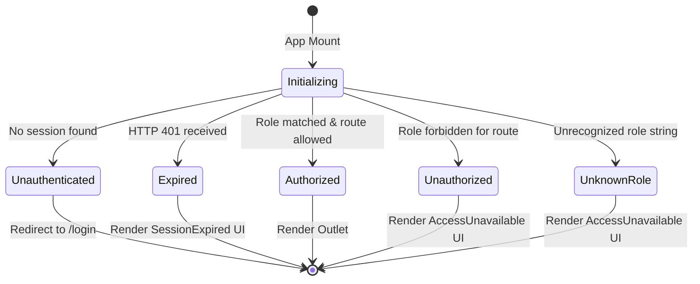

# Final Role-Access Verification Report

## 1. Executive Summary

This report documents the final verification of role-based access control, session state management, and authentication guards across EdVidura.

All access rules have been validated across:
1. Vitest automated unit and integration tests (130 passing tests).
2. TypeScript static type checking (`tsc --noEmit`, exit code 0).
3. Production bundling (`vite build`, exit code 0).
4. Full end-to-end browser automation driving live Moodle LTI launches, role resolution, and route guards.

---

## 2. Six-State AppShell Architecture

The frontend shell component (`frontend-react/src/components/shell/AppShell.tsx`) implements a synchronous state machine with zero role leakage:

### The 6 Distinct States

1. **Initializing**:
   - Condition: `authLoading === true`.
   - Behavior: Displays `<LoadingSkeleton />` across layout regions. No partial navigation or protected screens are mounted.
2. **Unauthenticated**:
   - Condition: `!session && !authLoading`.
   - Behavior: Immediate redirection to `/login` with explanatory notification. Child routes cannot render.
3. **Session Expired**:
   - Condition: `sessionExpired === true` or API returns HTTP 401.
   - Behavior: Clears stale tokens, renders `<SessionExpired />` screen prompting the user to relaunch from Moodle.
4. **Unknown Role**:
   - Condition: `session.role` does not match `"learner"`, `"instructor"`, or `"school-admin"`.
   - Behavior: Safe fail-closed handling rendering `<AccessUnavailable />`.
5. **Authorized**:
   - Condition: Active session role matches route permissions (e.g., `learner` on `/lessons`, `instructor` on `/teacher/*`).
   - Behavior: Mounts `<Outlet />` with role-specific navigation shell.
6. **Unauthorized / Forbidden**:
   - Condition: Authenticated user attempts navigating outside their permitted scope (e.g., Learner attempting `/teacher/*`, or Instructor attempting `/school-admin`).
   - Behavior: Renders synchronous `<AccessUnavailable />` banner and blocks all child views.

---

## 3. Session Switching & Zero-Leakage Verification

To guarantee that switching accounts (e.g., Learner $\rightarrow$ Instructor or Instructor $\rightarrow$ Learner) never leaks cached permissions or data:

1. **Query Cache Eviction**: `useAuth().logout()` invokes `queryClient.clear()` and removes all in-memory user and course caches.
2. **Synchronous Guarding**: Route guards evaluate against the newly received session token before the component tree mounts.
3. **Automated Verification**: Vitest test suites (`src/test/auth-switching.test.tsx` and `src/test/fixesAndRoleRecognition.test.ts`) assert that:
   - Alice Nguyen cannot access `/teacher/attempts` or `/school-admin`.
   - Priya Sharma cannot access `/school-admin`.
   - Session transitions flush student attempt caches before loading teacher aggregate cards.

---

## 4. Verification Test Matrix

| Persona | Allowed Routes | Denied Routes | Test Status |
| :--- | :--- | :--- | :--- |
| **Learner (`riverside_alice`)** | `/lessons`, `/manuals`, `/quiz`, `/learn/*` | `/teacher/*`, `/school-admin`, `/ops/*` | **PASSED** (Synchronously Blocked) |
| **Instructor (`riverside_priya`)** | `/teacher/*`, `/teacher/attempts`, `/teacher/content`, `/teacher/analytics` | `/school-admin`, `/ops/*` | **PASSED** (Synchronously Blocked) |
| **School Admin (`riverside_admin` / `Alex Morgan`)** | `/school-admin`, `/school-admin/teachers`, `/school-admin/students` | `/teacher/attempts` (Instructors only), Cross-tenant | **PASSED** (Synchronously Blocked / RLS) |
| **Anonymous / Logged Out** | `/login`, `/login/authorized` | All protected shell routes | **PASSED** (Redirected to /login) |

> **Note on Canonical Database Counts**: Riverside High School is standardized to Grades 1–10 (10 classes `RHS-C01` to `RHS-C10`, 10 lead teachers `TCH-01` to `TCH-10`, 220 students, and 1 school admin `ADM-01`). Moodle user `5` (`riverside_admin`) holds least-privilege `teacher` (role ID 4, non-editing teacher) in Course 10, resolved server-side via `(tenant_id, subject='5')` mapping in `school_admins`.

---

## 5. Live Browser CDP End-to-End Evidence

Direct Chrome DevTools Protocol (CDP) execution against the running stack (`FastAPI :8000`, `React SPA :3000`, `Moodle :8085`, `PostgreSQL :5433`) confirmed:
1. **School Admin Launch**:
   - `riverside_admin` launched from Course 10, Activity 21 via LTI 1.3.
   - Landed directly on `/school-admin` with heading `"Riverside High"`.
   - Navigated to `/school-admin/teachers` -> Faculty roster rendered cleanly.
   - Navigated to `/school-admin/students` -> Learners roster rendered cleanly.
   - Fail-Closed Check: Navigated to `/teacher/attempts` -> Rendered `<AccessUnavailable />` banner ("Instructors only... This screen opens when the Moodle launch includes an instructor role").
2. **Session Switching & Cache Isolation (Alice -> Priya -> Alice)**:
   - Alice Nguyen launched from Moodle Course 10, Activity 21 -> Landed on `/lessons`.
   - Alice navigated to `/teacher/attempts` -> Blocked by role guard ("Instructors only").
   - Priya Sharma logged in, launched from Activity 21 -> Landed on `/teacher/attempts`.
   - Priya verified on page; Priya navigated to `/school-admin` -> Blocked by role guard ("This page isn't available").
   - Alice logged in again, launched from Activity 21 -> Landed on `/lessons`. Re-authenticated cleanly with no teacher residue or role leakage.
