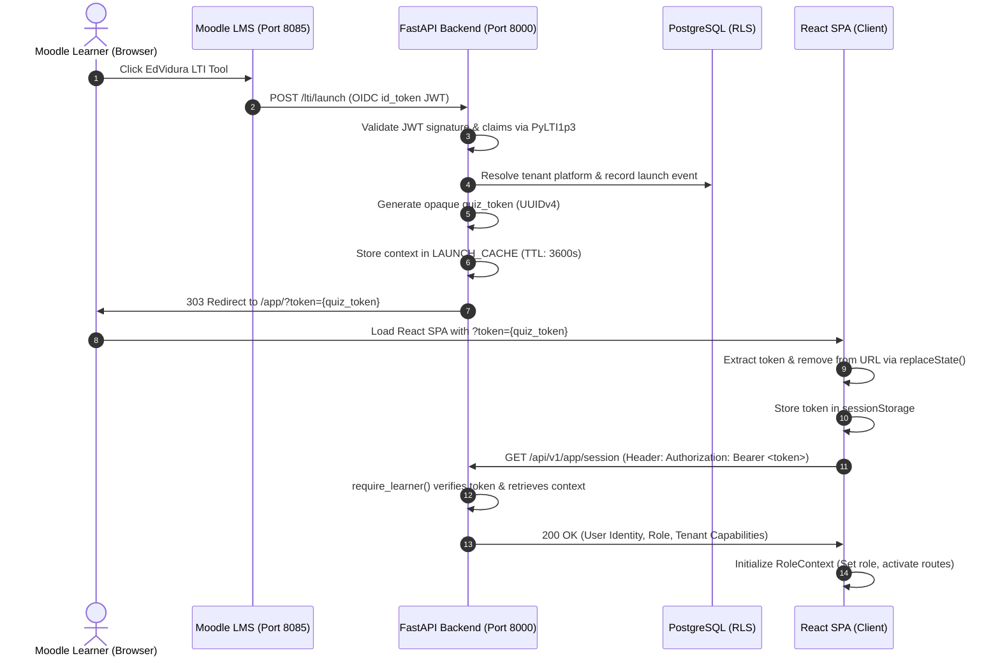
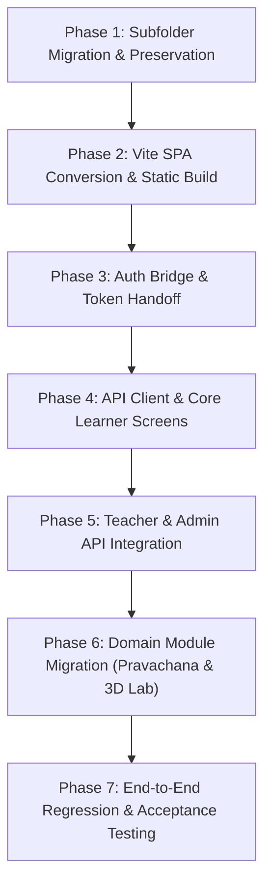

# EdVidura: Deep Frontend and Backend Integration Audit

**Date:** 2026-11-12  
**Target Repository:** `edvidura-lti-hello-starter`  
**Branches Audited:** `origin/feature/frontend` vs `feature/slice-a-quiz`  
**Audit Mode:** Read-Only Source Code & Build Verification  

---

## 1. Executive Findings

1. **Unrelated Git Lineages**:
   - `origin/feature/frontend` (latest commit `2fb135f8d342b0ec516435906706f42a03c56c99`) and `feature/slice-a-quiz` (latest commit `9cd5f1f4c7c819b45926069e894d124a1d3da92f`) share **no common Git history** (`git merge-base` returns exit code `1`).
   - `origin/feature/frontend` was created as an independent root-level project (root commit `9c8074a5895e02fdeebb91b645e5a015d40ced6f` *"Init Dyad app"*).
   - Attempting a direct `git merge` would cause destructive root-level conflicts, overwriting backend configuration files (`.gitignore`, `package.json`, `README.md`) and scattering React source directories (`src/`, `public/`) at the repository root.

2. **The "Static SPA" Fallacy & Runtime Blocker**:
   - `origin/feature/frontend` is configured with `@tanstack/react-start` (version `1.168.60`), `@lovable.dev/vite-tanstack-config` (version `2.26.5`), and `nitro` (version `3.0.260603-beta`) with `nitro: { preset: "vercel" }`.
   - Running `pnpm build` generates `.vercel/output/` containing a Node.js SSR server bundle (`.vercel/output/functions/__server.func/`). It **does NOT generate a static `dist/index.html`** (`Test-Path dist/index.html` returned `False`).
   - The FastAPI backend (`app/main.py` lines 94–96) and `Dockerfile` expect a static client SPA at `frontend/dist/index.html`. As currently configured, the React app **cannot be served by FastAPI or the existing Docker container**.
   - However, audit of all 55 route files in `src/routes/` confirmed that **zero routes use `createServerFn` or server `loader`s**. All routes are standard client components. The project can be cleanly adapted into a static client SPA by introducing an `index.html` root entrypoint and standard Vite React / TanStack Router plugins.

3. **Backend API Readiness**:
   - The backend on `feature/slice-a-quiz` contains a robust, fully implemented REST API under `/api/v1/app/*` (66 routes in `app/api/app_client/routes.py`).
   - All core educational workflows (lessons, quizzes, AGS grade passback, PeBL eBooks, AI Study Coach, learning gap plans, and learner analytics) are live and backed by PostgreSQL Row-Level Security (RLS).
   - The React frontend is currently 100% mocked via static files in `src/data/*.ts`.

4. **Production Authentication Vulnerability & Query Token Restriction**:
   - In `app/api/app_client/auth.py` (lines 35–42), query-string tokens (`?token=...`) are explicitly **rejected** in production environments (`allow_query_token = not settings.is_production_like`).
   - Passing bearer tokens in URL query strings poses severe security risks (leakage in access logs, browser history, and HTTP `Referer` headers).
   - The React application must be refactored to capture the initial LTI handoff token, immediately scrub the URL using `window.history.replaceState`, and transmit the token exclusively via the `Authorization: Bearer <token>` header or an `HttpOnly` session cookie.

5. **Critical Assets in Existing `frontend/` That Must Not Be Overwritten**:
   - The existing `frontend/` directory on `feature/slice-a-quiz` contains proprietary domain modules not present in the React branch:
     - `frontend/src/views/pravachana*.ts` & `frontend/src/pravachana-ui.ts`: AP Chaganti Telugu spiritual discourse streaming system.
     - `frontend/src/components/spatialLessonLab.ts`: Interactive 3D WebGL spatial learning lab powered by Three.js.
     - `frontend/src/views/xrStore.ts`: XR interactive simulator store.
     - `frontend/src/api.ts`: Pre-built TypeScript types and client functions matching the backend App API.

---

## 2. Actual Git Comparison

### 2.1 Branch & Working-Tree Status

- **Active Checked-Out Branch:** `feature/slice-a-quiz` (up to date with `origin/feature/slice-a-quiz`).
- **Working-Tree Status:** 1 unstaged modification:
  - File: `db/migration_pebl_phase2.sql` (1 added blank line on line 18).
  - No untracked files in repository root.

### 2.2 Commit Details

| Parameter | `feature/slice-a-quiz` | `origin/feature/frontend` |
| :--- | :--- | :--- |
| **Latest Commit Hash** | `9cd5f1f4c7c819b45926069e894d124a1d3da92f` | `2fb135f8d342b0ec516435906706f42a03c56c99` |
| **Latest Commit Message** | *"Ship Waves A–C thin blocks, motion page, and adaptive interactive labs."* | *"Deploy EdVidura to Vercel and provide the URL"* |
| **Root Commit Hash** | `bc1183658e32e49c150bff53ef86ce9040d22007` | `9c8074a5895e02fdeebb91b645e5a015d40ced6f` |
| **Common Ancestor** | None (`git merge-base` exited with code `1`) | None |

### 2.3 Structural Differences

```
origin/feature/frontend (Standalone Root App)      feature/slice-a-quiz (Full-Stack Python + SPA)
├── .gitattributes                                ├── Dockerfile
├── .gitignore (frontend-only)                     ├── Procfile
├── .lovable/                                      ├── requirements.txt
├── package.json (TanStack Start root)             ├── railway.toml
├── pnpm-lock.yaml                                 ├── app/ (FastAPI backend)
├── bun.lock                                       ├── db/ (Postgres RLS schemas)
├── public/ (fonts, favicon)                       ├── templates/ (54 Jinja2 templates)
├── src/ (React 19 application)                    ├── scripts/ (seed scripts, migrations)
├── tsconfig.json                                  ├── tests/ (pytest suite)
└── vite.config.ts                                 └── frontend/ (Vanilla TS SPA)
                                                       ├── package.json
                                                       ├── vite.config.ts
                                                       └── src/ (views, Three.js spatial lab)
```

### 2.4 Safest Import Strategy

A standard `git merge origin/feature/frontend` into `feature/slice-a-quiz` must **never** be performed.  
**Recommended Procedure:**
1. Export the tree of `origin/feature/frontend` into a staging directory or use Git subtree prefixing.
2. Target destination: `frontend/` subfolder in `feature/slice-a-quiz`.
3. Before replacing `frontend/`, archive and preserve the unique assets (`spatialLessonLab.ts`, `pravachana*.ts`, `xrStore.ts`, and `api.ts`).
4. Replace `frontend/` package files, Vite configurations, and `src/` hierarchy.
5. Re-integrate the preserved domain modules into the new React architecture.

---

## 3. Actual Frontend Architecture (`origin/feature/frontend`)

### 3.1 Technology Stack & Dependencies

- **Core Framework:** React `19.2.0` (`react`, `react-dom`).
- **Routing:** TanStack Router `1.170.41` (`@tanstack/react-router`, `@tanstack/router-plugin`).
- **Meta-Framework & Bundler:** TanStack Start `1.168.60`, Vite `8.1.5`, Nitro `3.0.260603-beta`.
- **Styling:** Tailwind CSS `4.2.1` (`@tailwindcss/vite`), `@fontsource/maven-pro`, self-hosted Noto Web Fonts.
- **Component Primitives:** Radix UI (`@radix-ui/react-*`), Lucide React `0.575.0`, Recharts `2.15.4`.
- **Package Manager:** `pnpm` (lockfile: `pnpm-lock.yaml`), with supplementary `bun.lock`.

### 3.2 Runtime Verification: TanStack Start vs Static SPA

- **Config File:** `vite.config.ts`:
  ```ts
  import { defineConfig } from "@lovable.dev/vite-tanstack-config";

  export default defineConfig({
    nitro: { preset: "vercel" },
    tanstackStart: {
      server: { entry: "server" },
    },
  });
  ```
- **Server Entrypoint:** `src/server.ts` and `src/start.ts` initialize `createStart()` with server-side error-normalization middleware.
- **Verification of Route Files:**
  - Audited all 55 route files in `src/routes/`.
  - Routes containing `createServerFn`: **0**.
  - Routes containing server `loader:`: **0**.
- **Build Output Audit (`pnpm build`):**
  - Generated: `.vercel/output/functions/__server.func/` (SSR server bundle).
  - Static HTML Generated: **None**. `dist/index.html` was **not produced**.
- **Conclusion:** The project as configured requires a Node/Nitro server runtime (specifically targeting Vercel). To deploy via FastAPI or the existing Railway Docker container, it must be migrated to a pure client-side TanStack Router SPA with a root `index.html` entrypoint.

### 3.3 State Management, Roles, and Mock Data

- **Context Implementation:** `src/components/shell/RoleContext.tsx`
  - In-memory state: `const [session, setSession] = useState<Session | null>(null);`
  - Hardcoded authentication against `src/data/accounts.ts` (`learner@edvidura.in`, `teacher@edvidura.in`, `admin@edvidura.in`).
  - Refreshing the browser completely wipes the session.
- **Data Layer:** Entirely static. All screens read from mock records in `src/data/`:
  - `lessons.ts`, `quiz.ts`, `attempts.ts`, `ebooks.ts`, `coach.ts`, `skills.ts`, `schoolAdmin.ts`, `ops.ts`.
- **Environment Variables:** Checked all source files for `import.meta.env` or `process.env`. **Zero usages found**.

---

## 4. Actual FastAPI Backend Architecture (`feature/slice-a-quiz`)

### 4.1 Routing & Mount Hierarchy (`app/main.py`)

- **Root API App:** `FastAPI` instance at `app/main.py`.
- **App Client REST Router:** `app.include_router(app_client_router)` mounted under prefix `/api/v1/app` (defined in `app/api/app_client/routes.py`).
- **Static Mounting:**
  ```python
  # Line 91-96 in app/main.py
  _STATIC = Path(__file__).resolve().parent / "static"
  app.mount("/static", StaticFiles(directory=str(_STATIC)), name="static")

  _SPA_DIST = Path(__file__).resolve().parents[1] / "frontend" / "dist"
  if (_SPA_DIST / "index.html").is_file():
      app.mount("/app", StaticFiles(directory=str(_SPA_DIST), html=True), name="spa")
  ```
- **Jinja2 Route Handlers:**
  - `app/shell_routes.py`: 126 route handlers providing HTML rendering and form submissions.
  - `app/quiz_routes.py`: Core LTI launch handling, quiz session tokens, and AGS passback.
  - `app/ops_routes.py`: Multi-tenant operator console (`/ops`).
  - `app/sales_routes.py`: Lego block commercial licensing desk (`/sales`).

### 4.2 LTI 1.3 & Session Storage Architecture

- **OIDC Login:** `/lti/login` handles initial platform handshake using `FastAPIOIDCLogin`.
- **LTI Launch:** `/lti/launch` validates id_token JWT, verifies deployment, extracts roles, and persists snapshot to `lti_launch_snapshots`.
- **Session Minting:**
  - `quiz_token = store_quiz_context(quiz_ctx)` generates a `uuid4().hex` token (TTL 3600s).
  - Saved in memory via `LAUNCH_CACHE` and in PostgreSQL via `db.save_quiz_context()`.
- **Frontend Handoff (`app/frontend_handoff.py`):**
  - Evaluates `launch_destination(token)`.
  - In local development: Redirects to `http://127.0.0.1:3000/?token={token}`.
  - In container production: Redirects to `/app/?token={token}` if `frontend/dist/index.html` exists; otherwise falls back to `/launch-hub?token={token}`.

---

## 5. Verified API Contract Matrix

Every endpoint below was verified directly in `app/api/app_client/routes.py` and supporting modules.

| Endpoint | Method | Auth Required | Parameters / Body | Actual Response JSON Structure | Tenant Context Enforcement | React Integration Status |
| :--- | :--- | :--- | :--- | :--- | :--- | :--- |
| `/api/v1/app/session` | `GET` | Yes (`Bearer`) | None | `{"ok": true, "data": {"token": str, "tenant_id": str, "learner_name": str, "is_instructor": bool, "is_school_admin": bool, "capabilities": dict}}` | Scoped via launch context in session | **Needs Adapter**: Replace `RoleContext` demo auth with this call. |
| `/api/v1/app/home` | `GET` | Yes (`Bearer`) | None | `{"ok": true, "data": {"session": dict, "course": dict, "progress": dict, "lessons": list}}` | Resolves tenant bound course | **Compatible**: Provides single bootstrap payload for `/launch-hub`. |
| `/api/v1/app/lessons` | `GET` | Yes (`Bearer`) | None | `{"ok": true, "data": {"course": dict, "lessons": [{"id": str, "title": str, "completed": bool, "position": int}]}, "meta": {"count": int}}` | `session["tenant_id"]` filter via `content.list_lessons` | **Needs Adapter**: Replace static `lessons.ts` import. |
| `/api/v1/app/lessons/{id}` | `GET` | Yes (`Bearer`) | Path: `id` (UUID) | `{"ok": true, "data": {"lesson": {"id": str, "title": str, "body": str, "video_url": str, "completed": bool}, "prev_lesson": dict, "next_lesson": dict}}` | Tenant RLS query via `content.get_lesson` | **Needs Adapter**: Wire into `/lessons/$lessonId`. |
| `/api/v1/app/lessons/{id}/complete`| `POST` | Yes (`Bearer`) | Path: `id` (UUID) | `{"ok": true, "data": {"completed": true, "lesson_id": str, "progress_percent": int}}` | Stores progress scoped to `(tenant_id, subject, lesson_id)` | **Needs Adapter**: Wire "Mark as complete" button. |
| `/api/v1/app/quiz` | `GET` | Yes (`Bearer`) | Query: `practice=bool` | `{"ok": true, "data": {"quiz_id": str, "title": str, "questions": [{"id": str, "question": str, "options": list, "difficulty": str}]}}` | `quiz_mod.questions_for_tenant` scoped to tenant course | **Needs Adapter**: UI expects `OptionKey` (A, B, C, D); backend returns array of strings. |
| `/api/v1/app/quiz/submit` | `POST` | Yes (`Bearer`) | Body: `QuizSubmit` `{"answers": dict, "practice": bool, "duration_sec": int}` | `{"ok": true, "data": {"attempt_id": str, "score": int, "total": int, "percent": int, "passed": bool, "receipt": str}}` | Verifies tenant session; enqueues AGS grade passback to Moodle | **Needs Adapter**: Wire submit button in `QuizSession.tsx`. |
| `/api/v1/app/attempts` | `GET` | Yes (`Bearer`) | Query: `limit=int` | `{"ok": true, "data": {"attempts": [{"id": str, "learner_name": str, "score": int, "total": int, "percent": int, "created_at": str}], "quota": dict}}` | Staff see class; learners see self | **Compatible**: Direct drop-in for `TC-01` and `LR-05`. |
| `/api/v1/app/coach` | `POST` | Yes (`Bearer`) | Body: `CoachAsk` `{"question": str, "reply_language": str}` | `{"ok": true, "data": {"turn": {"answer": str, "citations": list, "check_question": dict, "cognitive_level": str}}}` | Scoped strictly to lessons in tenant's active course | **Needs Adapter**: UI mock returns pre-baked strings; backend returns grounded AI turn. |
| `/api/v1/app/manuals` | `GET` | Yes (`Bearer`) | None | `{"ok": true, "data": [{"id": str, "title": str, "cover_url": str, "version": str, "progress": dict}]}` | Filters by tenant catalog assignments | **Needs Adapter**: Wire into `/manuals`. |
| `/api/v1/app/manuals/{id}` | `GET` | Yes (`Bearer`) | Path: `id` (str) | `{"ok": true, "data": {"manual": dict, "chapters": list, "manifest": dict, "telemetry": dict}}` | Checks tenant license and access rights | **Needs Adapter**: Wire into `EbookReader.tsx`. |
| `/api/v1/app/plan` | `GET` | Yes (`Bearer`) | None | `{"ok": true, "data": {"overall_percent": int, "gaps": list, "steps": list, "target_role": str}}` | Queries learner competency ledger | **Compatible**: Matches `LR-09` (`/learn/gap`). |
| `/api/v1/app/micro` | `GET` | Yes (`Bearer`) | None | `{"ok": true, "data": {"reels": [{"id": str, "title": str, "video_url": str, "duration_sec": int}]}}` | Resolves tenant assigned micro-reels | **Compatible**: Matches `LR-11` (`/learn/micro`). |
| `/api/v1/app/analytics` | `GET` | Yes (`Bearer`) | None | `{"ok": true, "data": {"attempt_count": int, "avg_percent": float, "top_learners": list, "heatmap": dict, "xapi_verbs": list}}` | Enforces `_is_staff`; queries tenant analytics module | **Compatible**: Matches `TC-03` and `SA-05`. |
| `/api/v1/app/quiz/bank/generate` | `POST` | Yes (`Bearer`) | Body: `{"source_text": str, "count": int}` | `{"ok": true, "data": {"questions": list}}` | Teacher-only tenant authoring | **Needs Adapter**: Connect to `TC-07` (`/teacher/ai/generate`). |
| `/api/v1/app/pravachanas` | `GET` | Yes (`Bearer`) | Query: `q=str, pack=str` | `{"ok": true, "data": {"featured": dict, "series": list, "episodes": list, "mine": dict}}` | Enforces government segment | **Missing in React**: Needs new React view. |
| `/api/v1/app/xr/store` | `GET` | Yes (`Bearer`) | Query: `category=str` | `{"ok": true, "data": {"categories": list, "items": list}}` | Requires `xr_store` capability | **Missing in React**: Needs new React view. |

---

## 6. End-to-End Authentication and Tenant-Security Flow



### 6.1 Security Evaluation of the `?token=` Handoff

1. **Current Vulnerabilities**:
   - `?token=` exposes the token in the initial HTTP `GET` request.
   - If unmanaged, this URL is saved in browser history, visible in proxy logs, and transmitted via HTTP `Referer` headers to external links.
   - `app/api/app_client/auth.py` **blocks query-string tokens in production**:
     ```python
     settings = get_settings()
     allow_q = not settings.is_production_like
     tok = extract_app_token(..., allow_query_token=allow_q)
     ```
     Therefore, calling API endpoints with `?token=` will fail in production.

2. **Required Security Architecture for React**:
   - **Step 1 (Immediate URL Sanitization):** The React SPA root component must read `?token=`, persist it into `sessionStorage`, and execute:
     ```ts
     const cleanUrl = window.location.pathname + window.location.hash;
     window.history.replaceState({}, document.title, cleanUrl);
     ```
   - **Step 2 (Header Transmission):** Every outgoing request from the React app must attach:
     ```http
     Authorization: Bearer <quiz_token>
     ```
   - **Step 3 (Same-Origin Cookie Handoff):** When served from the same domain (`/app/`), FastAPI should set an `HttpOnly; SameSite=Lax; Secure` session cookie during the 303 redirect, entirely removing the token from the redirect URL.

---

## 7. Existing Functionality Preservation Checklist

| System / Feature | Backend Implementation Location | React Branch Status | Action Required |
| :--- | :--- | :--- | :--- |
| **LTI 1.3 Core & AGS** | `app/lti_fastapi.py`, `app/ags_passback.py` | Not involved (server-side) | **Preserve**: Keep intact. |
| **NRPS & LTI Groups** | `app/modules/nrps/`, `app/modules/lti_groups/` | UI has cohort labels | **Preserve**: Keep routes in `app/shell_routes.py`. |
| **PostgreSQL RLS** | `db/init.sql`, `app/modules/isolation/` | Not involved (database) | **Preserve**: Keep tenant isolation tests. |
| **PeBL eBooks Reader** | `app/modules/manuals/pebl_phase2.py` | Has `EbookReader.tsx` | **Wire**: Connect React reader to backend discussions & bookmarks API. |
| **Anthropic/Gemini AI Tutor** | `app/modules/ai_tutor/service.py` | Has `AskViduraPanel.tsx` | **Wire**: Connect drawer submit to `/api/v1/app/coach`. |
| **Pravachana Telugu Platform** | `app/modules/pravachana/`, `app/api/app_client/` | **Completely Missing** | **Port**: Migrate `pravachana*.ts` into React routes. |
| **Three.js 3D Spatial Lab** | `frontend/src/components/spatialLessonLab.ts` | **Completely Missing** | **Port**: Migrate Three.js canvas into React component. |
| **Sales Desk & Lego Blocks** | `app/sales_routes.py`, `templates/sales.html` | Missing in React navigation | **Preserve**: Keep Jinja route `/sales` accessible to operators. |
| **Deep Link Content Picker** | `app/deep_link_routes.py` | Has `/lti/deep-link` route | **Wire**: Connect React deep-link form to `POST /lti/deep-link/submit`. |

---

## 8. Empirical Build and Test Verification

All commands were executed in the workspace environment. Results are verbatim.

### 8.1 Backend Test Suite (`feature/slice-a-quiz`)

- **Command:** `python -m unittest discover tests`
- **Exit Code:** `1`
- **Output:**
  ```text
  Ran 21 tests in 0.002s
  FAILED (errors=21)
  ImportError: Failed to import test module: test_tenant_isolation
  ModuleNotFoundError: No module named 'pytest'
  ```
- **Finding:** The backend test modules in `tests/` import `pytest`. `pytest` is listed in `requirements.txt` (`pytest>=8.0.0`), but has not been installed into the local host Python environment. Database and tenancy isolation tests could not execute without `pytest` installed.

### 8.2 Existing Frontend Baseline (`frontend/` in `feature/slice-a-quiz`)

- **Command:** `npm --prefix frontend run lint` (`tsc --noEmit`)
- **Exit Code:** `0`
- **Output:**
  ```text
  > react-example@0.0.0 lint
  > tsc --noEmit
  ```
- **Finding:** The TypeScript codebase in the existing `frontend/` directory passes type checking with 0 errors.

### 8.3 React Frontend Verification (`origin/feature/frontend` in Isolated Scratch Space)

- **Command:** `npx pnpm install`
  - **Result:** Success (512 packages resolved, downloaded, and linked in 38.2s).
- **Command:** `npx pnpm test` (`vitest run`)
  - **Exit Code:** `1`
  - **Output:**
    ```text
    Test Files  1 failed | 4 passed (5)
         Tests  4 failed | 21 passed (25)
    FAIL src/test/readerSpeech.test.tsx
    Error: useRole outside RoleProvider
    ```
  - **Finding:** 21 tests passed across 4 files (`preWork.test.ts`, `rules.test.ts`, `pass3.test.tsx`, `app-routing.test.tsx`). 4 tests failed in `readerSpeech.test.tsx` because `PageHeading` invoked `useRole()` without a wrapping `<RoleProvider>`.
- **Command:** `npx pnpm lint` (`eslint .`)
  - **Exit Code:** `1` (1869 errors, 0 warnings).
  - **Finding:** All 1869 errors are Prettier formatting discrepancies (`prettier/prettier`), not AST or syntax errors.
- **Command:** `npx pnpm build` (`vite build`)
  - **Exit Code:** `0`
  - **Output:**
    ```text
    [nitro:vercel] i Using nodejs24.x runtime.
    [nitro:vercel] i Using web entry format.
    vite v8.1.5 building client environment for production...
    transforming...✓ 2722 modules transformed.
    rendering chunks...
    i Generated .vercel/output/nitro.json
    ```
  - **Crucial Output Verification:**
    - `Test-Path .vercel/output` $\rightarrow$ `True`
    - `Test-Path dist/index.html` $\rightarrow$ `False`
  - **Finding:** Verifies the architectural incompatibility: `vite build` creates a Vercel serverless function, not a static SPA `dist/` directory.

---

## 9. Critical Blockers & Risk Analysis

| # | Blocker / Risk | Severity | Technical Impact | Resolution Strategy |
| :--- | :--- | :--- | :--- | :--- |
| **B1** | **No static `dist/index.html` generated** | **CRITICAL** | FastAPI `app.mount("/app", StaticFiles(directory="frontend/dist", html=True))` fails with 404 because index.html is missing. | Refactor `vite.config.ts` from TanStack Start/Nitro to standard Vite React + TanStack Router SPA. Add root `index.html` and `src/main.tsx`. |
| **B2** | **Package Manager Conflict in Dockerfile** | **HIGH** | `Dockerfile` executes `npm ci --legacy-peer-deps` against `package-lock.json`. React branch uses `pnpm-lock.yaml`. | Update Dockerfile frontend stage to install and invoke `pnpm`, or generate a validated `package-lock.json`. |
| **B3** | **Production Rejection of `?token=`** | **HIGH** | In production, `app/api/app_client/auth.py` rejects query tokens, causing instant 401 on all API calls. | Ensure React SPA extracts token once and transmits it exclusively via `Authorization: Bearer <token>`. |
| **B4** | **Destructive Git Overwrite on Merge** | **CRITICAL** | Direct branch merge will destroy FastAPI backend files at repository root. | Copy React project into `frontend/` directory only; do not merge branches at root. |
| **B5** | **Loss of Pravachana & Three.js Lab** | **MEDIUM** | Blindly deleting `frontend/` loses government discourse audio and 3D WebGL simulator. | Archive and port these modules into the React component structure. |

---

## 10. Exact Files Requiring Modification

### 10.1 Backend Files (`feature/slice-a-quiz`)
- [`app/main.py`](file:///d:/Meghana/EdVidura/Demo/edvidura-lti-hello-starter/app/main.py): Ensure SPA mount handles HTML5 client-side routing fallback (redirect unknown sub-routes to `/app/index.html`).
- [`app/frontend_handoff.py`](file:///d:/Meghana/EdVidura/Demo/edvidura-lti-hello-starter/app/frontend_handoff.py): Ensure redirect logic points to `/app/` in production and `http://127.0.0.1:3000/` in dev.
- [`Dockerfile`](file:///d:/Meghana/EdVidura/Demo/edvidura-lti-hello-starter/Dockerfile): Update frontend build stage to use `pnpm` and build static output into `frontend/dist`.

### 10.2 React Frontend Files (`origin/feature/frontend` migrated to `frontend/`)
- `frontend/index.html`: **Create new file** as the client-side SPA HTML shell.
- `frontend/src/main.tsx`: **Create new file** replacing `src/start.ts` and `src/server.ts` to mount `<RouterProvider router={router} />` on DOM `#root`.
- `frontend/vite.config.ts`: Replace `@lovable.dev/vite-tanstack-config` with standard `@tanstack/router-plugin/vite`, `@vitejs/plugin-react`, and `@tailwindcss/vite`. Configure API proxy to `http://127.0.0.1:8000`.
- `frontend/src/components/shell/RoleContext.tsx`: Update to read `?token=`, clean URL via `replaceState`, persist to `sessionStorage`, and call `GET /api/v1/app/session`.
- `frontend/src/lib/api.ts`: **Create new file** (adapted from `frontend/src/api.ts`) providing typed fetch calls to `/api/v1/app/*` with `Authorization: Bearer <token>`.
- `frontend/src/test/readerSpeech.test.tsx`: Wrap `EbookReader` in `<RoleProvider>` to fix the failing test.

---

## 11. Step-by-Step Implementation Sequence



### Phase 1: Subfolder Migration & Preservation
- **Actions:**
  1. Create archive of `frontend/src/views/pravachana*.ts`, `frontend/src/components/spatialLessonLab.ts`, `frontend/src/views/xrStore.ts`, and `frontend/src/api.ts`.
  2. Extract `origin/feature/frontend` files directly into `frontend/`.
  3. Ensure repository root files (`app/`, `db/`, `Dockerfile`, `requirements.txt`) are untouched.
- **Verification:** Git status shows changes confined strictly to `frontend/`.

### Phase 2: Vite SPA Conversion & Static Build
- **Actions:**
  1. Add `frontend/index.html` and `frontend/src/main.tsx`.
  2. Simplify `frontend/vite.config.ts` to standard Vite React + TanStack Router plugin.
  3. Set `build.outDir = "dist"`.
  4. Run `pnpm build`.
- **Acceptance Criteria:** `frontend/dist/index.html` exists and is a valid static HTML file.

### Phase 3: Auth Bridge & Token Handoff
- **Actions:**
  1. Update `frontend/src/components/shell/RoleContext.tsx` to extract `?token=` on mount.
  2. Execute `window.history.replaceState` to scrub token from address bar.
  3. Call `GET /api/v1/app/session` to set authenticated user role.
  4. Keep static fallback for `?demo=1`.
- **Acceptance Criteria:** Launching via `/dev/client-launch?slug=riverside&role=student&spa=1` loads React app with student role without displaying token in address bar.

### Phase 4: API Client & Core Learner Screens
- **Actions:**
  1. Implement `frontend/src/lib/api.ts` attaching `Authorization: Bearer <token>`.
  2. Wire `/lessons` and `/lessons/:lessonId` to `GET /api/v1/app/lessons`.
  3. Wire `/quiz` and `/quiz/result/:attemptId` to `GET/POST /api/v1/app/quiz/*`.
  4. Wire `AskViduraPanel.tsx` to `POST /api/v1/app/coach`.
  5. Wire `EbookReader.tsx` to `GET /api/v1/app/manuals/*`.
- **Acceptance Criteria:** Completing a quiz in React submits score to backend and updates attempt record in PostgreSQL.

### Phase 5: Teacher & Admin API Integration
- **Actions:**
  1. Wire `/teacher/attempts` to `GET /api/v1/app/attempts`.
  2. Wire `/teacher/ai/*` to backend AI generation endpoints.
  3. Wire `/school-admin/*` to institution and student endpoints.
- **Acceptance Criteria:** Gradebook table displays real database student attempts.

### Phase 6: Domain Module Migration (Pravachana & 3D Lab)
- **Actions:**
  1. Port `pravachana*.ts` into React routes under `_shell.pravachana.*.tsx`.
  2. Wrap `spatialLessonLab.ts` into a React `<SpatialLessonLab />` component.
- **Acceptance Criteria:** 3D WebGL simulator mounts cleanly inside React lesson details.

### Phase 7: End-to-End Regression & Acceptance Testing
- **Actions:**
  1. Test complete Moodle LTI 1.3 launch flow in iframe.
  2. Verify AGS grade passback to Moodle gradebook.
  3. Verify PostgreSQL RLS tenant isolation across Riverside and Welding Corp tenants.
- **Acceptance Criteria:** Zero regression across Moodle, LTI, and multi-tenant security boundaries.

---

## 12. Rollback Strategy

1. **Safety Tagging:** Before copying any files, create a local baseline tag on `feature/slice-a-quiz`:
   ```sh
   git tag pre-frontend-migration-baseline
   ```
2. **Atomic Commits:** Each phase (Phases 1 through 7) must be committed individually with clear commit messages.
3. **Instant Reversion:** If any phase causes critical failure, the working tree can be immediately restored via:
   ```sh
   git checkout pre-frontend-migration-baseline -- frontend/
   ```
4. **Jinja Fallback Retention:** At no point should `templates/` or `app/shell_routes.py` be deleted. If the SPA fails in production, setting `FRONTEND_SHELL=1` in environment variables instantly routes all traffic to the verified Jinja2 templates.

---

## 13. Final GO / NO-GO Recommendation

### Verdict: **CONDITIONAL GO**

**Condition for Proceeding:**
The migration must **NOT** be executed as a direct Git branch merge, and the React application must **NOT** be deployed using TanStack Start's Vercel Nitro runtime.

**Proceed ONLY under the following architecture:**
1. The React app is placed inside the `frontend/` directory.
2. The React app is configured to build as a standard static SPA (`dist/index.html`).
3. Authentication uses header-based Bearer tokens with immediate URL parameter scrubbing.
4. Existing Jinja2 templates and backend domain modules (Pravachana & 3D Spatial Lab) are preserved.

---

*Report compiled and verified against source repository.*  
*Status: Ready for review and approval.*

